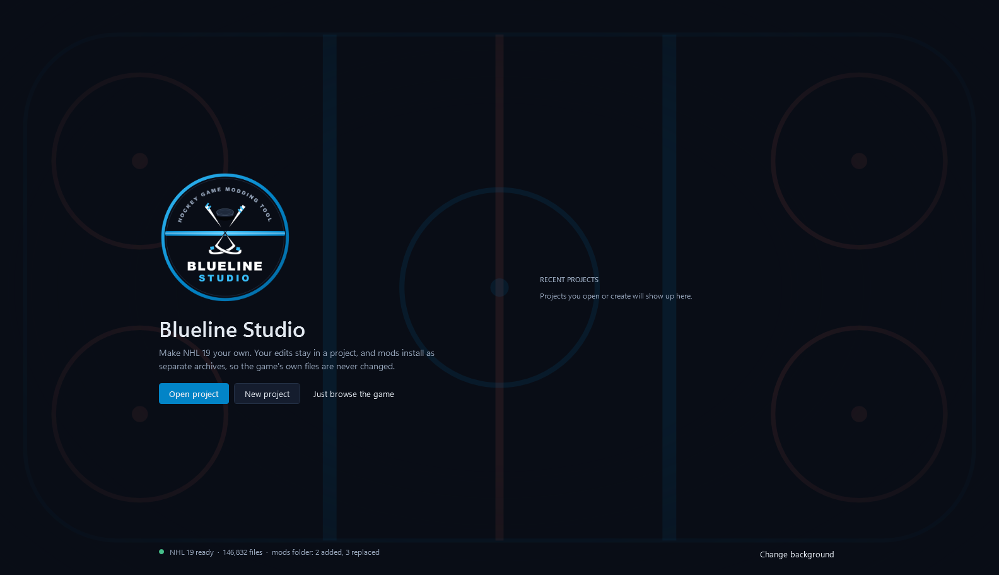
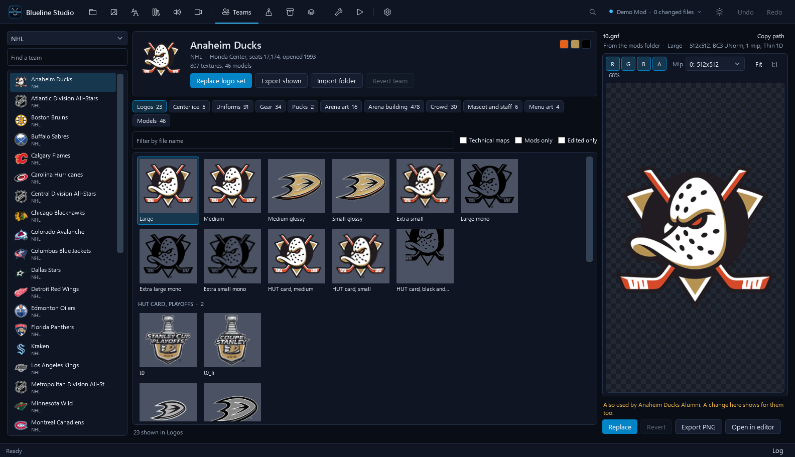
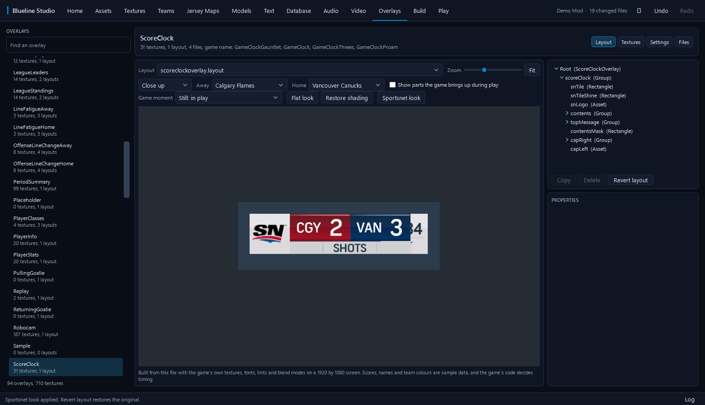
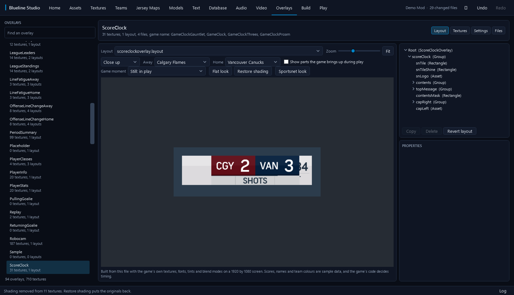

<p align="center">
  
</p>

<h1 align="center">Blueline Studio</h1>

<p align="center">
  A modding suite for <b>NHL 19 on PS4</b>. Browse the game, replace textures, edit teams, jerseys, text and overlays,
  and install your changes as separate archives, so the game's own files are never touched.
</p>



> **Honest status.** Tested on one game dump (NHL 19, CUSA11126, version 1.60) under the shadPS4 emulator only.
> Retail PS4 has never been tried. Most editors are proven on real files by automated tests, but few changes have been
> *seen in game* yet. [docs/STATUS.md](docs/STATUS.md) says exactly what is proven and what is not, per feature.

## What you can do

| Tab | In short |
|---|---|
| **Assets** | Browse and search all ~147,000 game files, see which archive wins, export, jump to the right editor |
| **Textures** | Preview channels, mips and faces. Export PNG or exact DDS. Import one image or a whole folder |
| **Text** | Search and edit every string in every language. CSV import and export |
| **Database** | Every table of every database, cell editing, valid checksums after an edit |
| **Audio** | Browse sound banks. With EA's `sx.exe`: listen, export WAV, replace a sample in its slot |
| **Video** | Play, export, and replace the game's `.mkv` and `.vp6` videos (needs FFmpeg) |
| **Teams** | Every team's logos, uniforms, arena, crowd and more, with a 3D uniform view. Replace or revert any picture |
| **Jersey Maps** | Make a jersey's normal and coeff maps from its colour sheet or a picture |
| **Models** | 3D preview with orbit and zoom, hide shapes, export OBJ |
| **Overlays** | All 94 on-screen graphics drawn with the game's own art. Edit layouts, textures and settings. Score clock moments (goal, power play and more) are previewed. One click gives the score bug a flat, modern look |
| **Build** | See every change, revert any one, build with read-back verification, install, uninstall. Combine another mod safely |
| **Play** | Launch the game in shadPS4, edit its settings, read the live log |



### Also

- **Ctrl+K** opens a command palette to jump to any tab, run an action, or find a game file.
- Dark and light themes, with an optional start screen picture of your own.
- Undo and redo across every edit. A log panel records everything the tool does.
- A `blueline` command line for scripting: audit, find, extract, projects, build, install and uninstall.

| Flat scorebug, before | Flat scorebug, after |
|---|---|
|  |  |

## How mods are kept safe

- Your edits live in a **project folder**, stored by content hash. Nothing is written to the game while you edit.
- **Build** writes new `patch_*_99_*` archives and reads every file back to check it.
- **Install** copies those archives into the game's `databigs` folder. **Uninstall** deletes only what was installed.
- The original game archives are never modified, so there is no giant backup to keep.

## Get started

You need:

- **Windows** and the **.NET 10 SDK**
- Your own **NHL 19 PS4 dump** (the folder that holds `databigs`). Blueline does not include or download any game files.
- Optional: EA's `sx.exe` for audio, and FFmpeg (with `ffprobe.exe` beside it) for video. Neither is bundled.

```bash
git clone https://github.com/SonkuModz/Blueline-Studio.git
cd Blueline-Studio
dotnet build Blueline.slnx
```

```bash
src/Blueline.App/bin/Debug/net10.0-windows/BluelineStudio.exe
```

1. On the start screen choose **Open project** or **New project**.
2. Open **Settings** (Ctrl+,) and choose your game folder, plus `sx.exe` and FFmpeg if you want audio and video.
3. Edit in any tab. Every change shows up in **Build**.
4. On **Build**, press **Build**, then **Install**. Press **Uninstall** to undo it.

The full walkthrough, with troubleshooting, is in the **[User guide](docs/USER_GUIDE.md)**.

## Known limits, at a glance

- Not tested on a retail PS4. Tested under shadPS4 only.
- Changes to the game's layout files (`boot.big` content) do **not** load through patch archives. Textures do. This is
  why overlay layout edits may not appear in game.
- Models are read-only. Audio replacements must fit the original slot.
- Full list: [docs/STATUS.md](docs/STATUS.md#limits).

## For developers

```bash
dotnet test tests/Blueline.Tests
```

The tests read the real game, so they need the dump at `NHL 19/CUSA11126` inside the repo folder (it is git-ignored).

- [docs/ARCHITECTURE.md](docs/ARCHITECTURE.md): how the code is organised
- [docs/RESEARCH.md](docs/RESEARCH.md): file format findings and old claims retested
- [docs/SPORTSNET_BUG.md](docs/SPORTSNET_BUG.md): measurements for a custom score bug
- [CONTRIBUTING.md](CONTRIBUTING.md): how to report a problem or send a change

## License

The code is [MIT licensed](LICENSE). The MIT license covers Blueline's code only, not the game, team marks or logos.

## Legal

Blueline Studio is a fan-made tool. It is not made, endorsed or supported by Electronic Arts. NHL, team names and logos
belong to their owners. No game content is included in this repository; you supply your own legally obtained copy of
the game. Use mods on your own copy, and respect the game's and the platform's terms.
