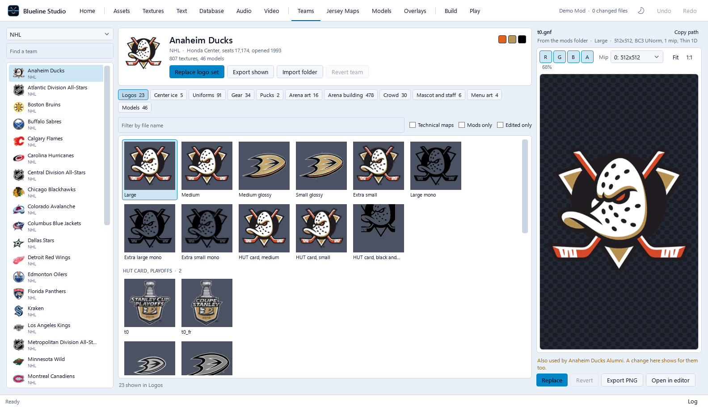
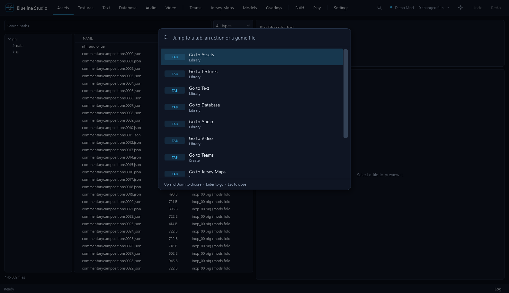
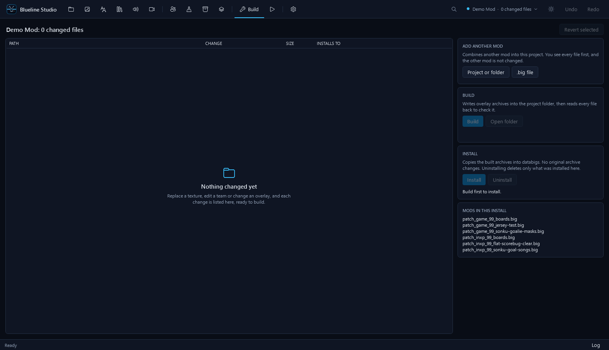
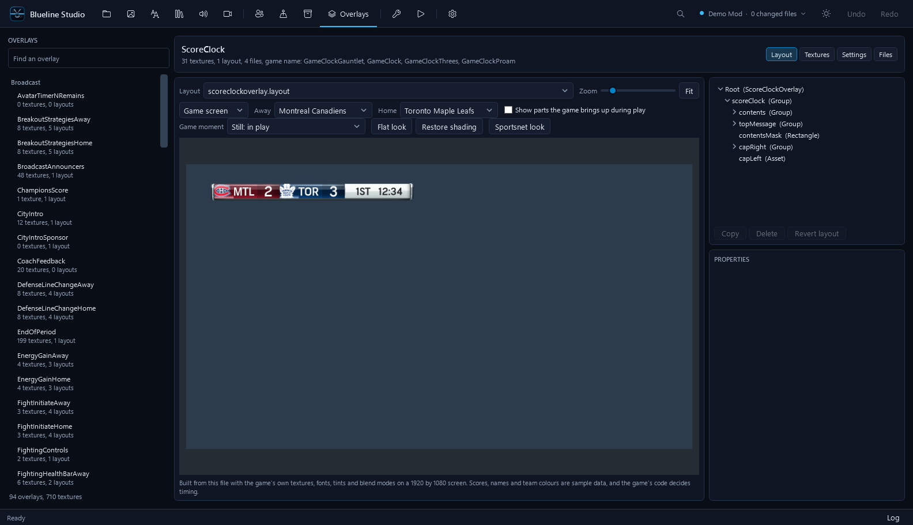

# Blueline Studio user guide

For people who just want to make mods. For what is proven and what is not, see [STATUS.md](STATUS.md).

## 1. Before you start

| You need | Why |
|---|---|
| Windows 10 or 11 and the .NET 10 SDK | to build and run the app |
| Your own NHL 19 PS4 dump | the folder named like `CUSA11126` that contains `databigs` |
| shadPS4 (optional) | to try mods; the Play tab launches it |
| EA's `sx.exe` (optional) | audio: listen, export, replace |
| FFmpeg with `ffprobe.exe` beside it (optional) | video playback and replacement |

Blueline never downloads or ships game files, `sx.exe` or FFmpeg.

## 2. First launch

1. Build and run (see the [README](../README.md#get-started)).
2. The **start screen** appears. Choose **Open project**, **New project**, or **Just browse the game**.
3. Open **Settings** (Ctrl+, or the cog at the end of the tab bar) and pick your **game folder**. Blueline reads the
   archives and shows the file count when it is ready.
4. Optional: choose `sx.exe` and FFmpeg in Settings. Tabs that need them tell you if they are missing.

## 3. Finding your way around

- The top bar is grouped: **Library** (look and export), **Create** (make changes), **Ship** (build and play).
  The cog opens **Settings**. Hover a tab for its name and shortcut; Ctrl+1 to Ctrl+9 jump to the first nine tabs.
- **Ctrl+K** opens the command palette. Type a tab name, an action, or part of a file name such as `burn 01`.
  Enter opens the first result.
- The project chip shows the open project and how many files changed. Its menu has undo, redo, new, open, show
  folder, close, and back to start.
- Everything you change can be undone. Nothing touches the game until you press **Install**.

## 4. A first mod, step by step

Replace a team logo as an example.

1. **New project** and give it a name.
2. **Teams**: choose a team, then **Replace logo set** and pick a picture, or select one logo and press **Replace**.
3. **Build** shows the changed files. Remove any one with **Revert selected**.
4. Press **Build**. Blueline writes the archive and reads every file back to check it.
5. Press **Install**. The archive is copied into the game's `databigs` folder.
6. Start the game (the **Play** tab does this in shadPS4) and look.
7. To remove the mod, press **Uninstall**. Only files Blueline installed are deleted.

## 5. Tab notes

- **Assets**: search by path. The Archive column shows which file wins when several hold the same path.
- **Textures**: import keeps the original size and format where it can. Cubemaps, float and volume textures preview
  and export only.
- **Teams**: warnings appear when a picture is shared with another team, so a change would show for both.
- **Jersey Maps**: start from the colour sheet, move the sliders, compare with the current maps, then save.
- **Overlays**: pick an overlay on the left. The preview uses the game's textures with sample teams and scores. Use
  the **Game moment** list to see the score clock during a goal or power play. **Flat look** removes the shading from
  the score bug using textures only; **Restore shading** brings it back.
- **Audio** and **Video** need the optional tools above.
- **Play**: shows the game's art, installed mods, controls, and a form for shadPS4 settings. Saving keeps a backup of
  the original file, and **Restore original file** puts it back.

## 6. Combining mods

On **Build**, **Add another mod** takes a Blueline project, a `.big` file, or a folder of them. You see every file
first, with conflicts and warnings. Only what you tick is taken, as a single undo step. Two mods that edit the *same*
database or language file cannot be merged inside the file: one wins and the review tells you.

## 7. Troubleshooting

| Problem | What to try |
|---|---|
| "Choose the game folder in Settings" | Open Settings and pick the folder that contains `databigs` |
| Audio or video buttons are greyed | Choose `sx.exe` or FFmpeg in Settings |
| Install says it cannot write | Close the game and the emulator first; archives are locked while it runs |
| A texture looks like noise in game | Some re-encoded textures have shown noise in game and the cause is not known. Revert that texture on **Build** and report the file name |
| An overlay layout change does not appear | Layout files from `boot.big` do not load through patch archives. Texture changes do |
| The mod does nothing | Make sure the archive appears under **Build > Mods in this install**, then restart the game |
| Something else | Open the **Log** at the bottom right and check `%LOCALAPPDATA%\Blueline\logs` |

## 8. Safe habits

- Keep your original dump untouched and work in projects.
- Use **Uninstall** rather than deleting archives by hand.
- Close the game before installing or uninstalling.
- If you use another mod manager, close Blueline while it installs mods, then reopen Blueline.
