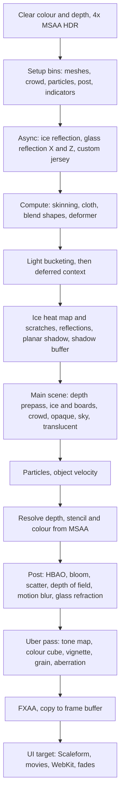
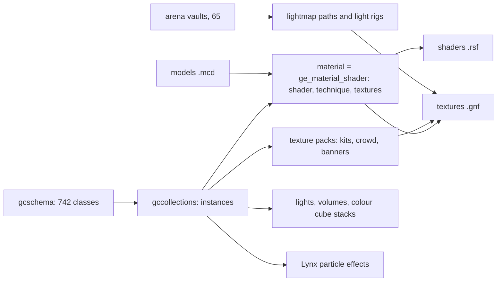

# How NHL 19's visuals work (PS4, CUSA11126, version 1.60)

A reverse-engineering reference for everything the player sees: how a frame is built, how materials, lighting,
characters, arenas, the ice, the crowd, effects, post-processing, the interface and video reach the screen, and what
that means for modding.

**Method and certainty.** Everything here comes from the supplied dump: the game's own data files (read through
Blueline's file system), its configuration and the `.scrape` frame scripts, the compiled shader files, and the
`eboot.bin` (a decrypted ELF: its strings, symbol-like type names, console variable tables and constant buffer names).
Labels used throughout:

| Label | Meaning |
|---|---|
| **Read** | the text or bytes were read directly from a game file and say exactly this |
| **Counted** | measured by a script over all files (counts are for this dump) |
| **Inferred** | follows from names and structure, never confirmed by running the game |
| **Unknown** | not worked out |

Nothing here was copied from other EA titles. Where the earlier notes in [RESEARCH.md](RESEARCH.md) already cover a
topic (archive format, GNF textures, `.mcd` models, overlays, video) this document links to them rather than repeating
them.

---

## 1. The big picture

A frame is produced by a **script-driven forward renderer with an optional deferred recording step**, written for
Sony's GNM graphics API, with **4x MSAA** HDR colour (`R11G11B10_FLOAT`) and a full post-processing stack.

```
 game simulation ──► render streams ──► render objects (bins) ──► frame script (.scrape) ──► GPU
                                              │                         │
                       materials (.rsf effects, PS4 shader binaries)    ├─ shadows, reflections, ice
                       textures (.gnf, tile mode 13)                    ├─ main scene + crowd + particles
                       models (.mcd)                                    ├─ MSAA resolve ─► post-processing
                       lighting data (lightmaps, SH probes, volumes)    └─ UI (Scaleform) ─► screen
```

Key facts, each explained in the sections below:

- The whole frame order is a **text script**, `nhl/data/kettle/scrape/sample_backend.scrape` (**Read**, section 4).
  Passes, render targets, formats and resolutions are defined there, not in compiled code.
- Draw ordering uses **render bins** defined in `nhl/data/common/config/samplerenderbins.xml` (**Read**, section 5).
- Every surface is drawn by a **material = a compiled `.rsf` effect** (337 files, 6,049 GPU binaries, **Counted**,
  section 6). Families: `pbr_*` and `enviro_*` for arenas, `pbr_player_*` and `player_*` for skaters, `crowd_*`,
  `lynx*` for particles, `cs_*` for compute.
- Lighting is **clustered** (a compute shader buckets lights into screen cells) plus **baked lightmaps** (BC6H),
  **spherical harmonic probes**, **local reflection volumes** and pre-integrated BRDF cube maps (section 7).
- The picture is finished by a **post stack**: HBAO, bloom, hex bokeh depth of field, volumetric scatter, motion blur,
  glass refraction, tone mapping, a baked **colour cube** stack, FXAA, film grain, vignette, chromatic aberration
  (section 10).
- The interface is **Scaleform GFx** (Flash) drawn to its own buffer after the 3D frame (section 11).

---

## 2. The program: what `eboot.bin` is

### 2.1 Format

A plain, decrypted 64-bit x86-64 ELF (`7F 45 4C 46`, machine `0x3E`, 100,369,766 bytes). **Read** from the program
headers:

| # | Type | File offset | Virtual address | Size | Notes |
|---|---|---|---|---|---|
| 0 | LOAD (R+X) | `0x4000` | `0x0` | `0x56EA4B0` (92.9 MB) | code and read-only data together, `file = vaddr + 0x4000` |
| 1 | SCE_RELRO | `0x56F0000` | `0x56EC000` | `0x276680` | relocations made read-only |
| 2 | LOAD (R+W) | `0x5968000` | `0x5964000` | `0x70BE0` file, `0x9BB060` memory | data and zero-filled bss (about 10 MB) |
| 3 | SCE_PROCPARAM | `0x5968000` | `0x5964000` | `0x50` | process parameters |
| 4 | DYNAMIC | `0x5FB60B8` | | `0xD00` | |
| 6 | TLS | `0x5968060` | | `0x20` memory | |
| 7 | EH_FRAME | `0x55CBD44` | `0x55C7D44` | `0x12276C` | exception unwind tables |
| 8 | SCE_DYNLIBDATA | `0x59D8C00` | | `0x5DE1B8` | Sony dynamic linking data |
| 9 | SCE_COMMENT | `0x5FB6DC0` | | `0x3C` | build path (below) |
| 10 | SCE_VERSION | `0x5FB6DFC` | | `0x176A` | linked library versions |

Entry point `0x80`. There are no section headers (`shnum` 0), so there are no function names; names below come from
strings (type-name templates, console variable tables, resource keys and source paths).

### 2.2 Who built it

- **Read** build comment: `PATH4 ... E:/P4/NHL19/1.6.0/build/runtime/nhlkettlezf.elf`. The Perforce depot path puts the
  project at `NHL19/1.6.0`; `nhlkettlezf` is the PS4 ("kettle") final configuration. Source paths in the file begin
  `E:/P4/NHL19/1.6.0/` and name these trees: `wfdk` (a framework layer), `nhl/gamemodes`, `nhl/ui`, `wf/online`
  (`EAStore`, `wfonline_framework`), `wf/audio` (`EAAudioCore` 10.12.00 with Speex decoding).
- Studio internal names recurring in type names and data: **Tiburon** (EA's Orlando studio, **Read** as a tag inside
  every compiled shader), `nhlrender::` (render namespace), `Sample::Render::` (the render framework), `Game::Bind::`
  (interfaces game code exposes to the renderer), `EA::Cram::` / `EA::CramScene::` (the asset and scene system,
  section 3), `Lynx` (particles), `RNA` (the device layer: `RNA::Core::IDeviceContext`), `TABU` / `Tabu` (profiler and
  camera helpers), `EA::Type::` (a reflection and scripting type system) and `Frostbite.Animation.Support` (the
  animation library, **Read** in an error message about VBR clip compression).
- **Inferred:** the animation code is Frostbite's, the renderer is EA Sports' own. It is not a Frostbite renderer
  (no Frostbite shader or render path names appear; the render passes are the `Sample`/`RNA` ones above).
- **Shared lineage with a fighting game (Inferred).** The program and data contain classes and strings for a different sport:
  `ge_fighting_playerhair`, `ge_fighting_blendtargetgameplaymap`, the `Fighting` enum, `octagon_mat` and `octagon_mat_decal` materials,
  `isMatchInOctagon`, `isCageTransparencyOn`, `isRefTransparencyOn`, `IsUserCareerFighter`, `CapFighter`, `FighterBannerComponent`
  (banner slots `BANNERSLOT0..6`, `BannerBlueCorner`), `CramRenderableGymMonkeyComponent`, `cage_*` shaders and `bgs_fighting_hud_damage_off`.
  The scene system, materials and tools are therefore shared with EA's fighting title; hockey reuses them and its unused fighting pieces remain.
  This is why NHL materials are called `ge_material_*` and why damage, sweat, bruising and blood systems are so developed.

### 2.3 Sony libraries linked

From the SCE_VERSION segment and strings (**Read**): `libSceGnf` (GNF texture container), `libSceGpuAddress` (tiling
maths), `libSceShaderBinary` (loads `OrbShdr` shader binaries), `libSceGnmDriver` and the static `libSceGnmx`
(GfxContext: `gnmx/gfxcontext.cpp`, `GnmxCue`, `GnmxCueHeap`), plus `libSceAjm` (audio decode), `libScePad`,
`libSceAudioOut`/`Audio3d`, network and NP libraries, `libSceSpeechRecognition` and `libSceCes`. Two modules ship beside
the program in `sce_module`: `libc.prx` and `libSceFios2.prx` (file I/O).

### 2.4 What this means

The game talks to the GPU through Gnmx command contexts, with its own thin layer (RNA) above that and the script
interpreter (section 4) above RNA. Shaders are loaded from the `.rsf` effect files in the archives, not built into the
program (section 6).

---

## 3. Getting data to the renderer

### 3.1 Where the visual data lives

Counted over the **141,769 stock paths** (the game's own archives, without the mods folder). Sizes are stored sizes in binary units
(1 MB = 1,048,576 bytes), and this convention is used throughout the document.

| Path | Files | Size | What |
|---|---|---|---|
| `nhl/data/kettle/rendering/stadiums` | 52,673 | 2.7 GB | arenas: models, textures, lightmaps |
| `nhl/data/kettle/rendering/characters` | 33,809 | 20.6 GB | players, goalies, referees, coaches, mascots, crowd members |
| `nhl/data/kettle/rendering/customlogos` | 4,677 | 577 MB | per-club custom logo layers |
| `nhl/data/kettle/rendering/textures`, `effects`, `model`, `skeleton` | 195 | 36 MB | trophy and podium props, particle textures, models, skeletons |
| `nhl/data/kettle/shaders` | 337 | 10.9 MB | the materials (`.rsf`) |
| `nhl/data/kettle/scrape` | 5 | 0.1 MB | the frame scripts |
| `nhl/data/kettle/movie`, `nhl/data/common/movie` | 716 | 6.8 GB | video (`.mkv`, `.vp6`), see RESEARCH 6.8 |
| `nhl/data/common/rendering`, `postfx`, `spotlight`, `ice`, `font` | 166 | 24 MB | BRDF tables, colour stacks, ice data, fonts, spotlight gobos |
| `nhl/data/common/gamedata` | 1,902 | 388 MB | animation clips (`.cba`), play data, `stadiumlighting.json` |
| `nhl/data/common/camera` | 93 | 0.1 MB | commentary camera shots |
| `nhl/data/common/database/attrib` | 142 | 12 MB | the attribute vaults (9.1) |
| `nhl/ui` (`kettle_assets`, `swfassets`, `features`, `lua`, `fonts`, `lib`) | about 45,400 | 4.3 GB | interface art, Scaleform, layouts and scripts |

`kettle` is the PS4 build; `common` is shared with other platforms. Files in `nhl/data/common/config` are **loose on
disk** next to the archives (memory budgets, the render bin list, preload list), not in a `.big`.

### 3.2 The asset system ("CRAM")

**Read** in the program: `EA::Cram::AssetManager`, `CramRenderableComponent`, `CramRenderablePlayerComponent`,
`CramRenderableTrainerComponent`, `CramConfigComponent`, `CramAssetRef`, `EA::CramScene::ISwapPartService`. A scene
object is a **bag of components** (renderable, light, lynx particle, crowd actor, power ring, jumbotron flipbook,
runtime texture, wrinkle, tattoo, dynamic emissive, light bucketing, cluster shadow, environment decay, transparent
environment, UV transform, 3D UI). Components carry named attributes, and the strings show the keys:

- Mesh component: `Models`, `ModelNumBindings`, `Lightmaps`, `LightmapAttribKey`, `ObjectMotionBlurEnabled`,
  `TextureSwapEnabled`, `VisualGroupEnabled`, `RequiresUniqueMaterials`, `PerMeshBoundingVolumes`, `FadingType`,
  `SkeletonStateStreamFormat` (`HALF_NOSCALE`, `HALF_PACKED`, `HALF_FIXED`, `HALF_FIXED_LOCAL`),
  `SkeletonQuatInterpolationType` (`SPHERICAL`, `HERMITE`), `ShadowCaster`, `ShadowReceiver`, `NearCameraFading`,
  `ClothSimEnabled`, `ClothMinTimeStep`, `ClothMaxTimeStep`, `LodCategory`, `LodSettings`, `DispatchBucket`,
  `SwappartOverride`, `SwappartRandomize`, `RenderAttribute`, `CBufferName`, `CBufferSize`, `VarOffset`.
- `ge_*` and `data_dof_*` prefixes mark data-driven tables and animation-driven values (for example
  `data_dof_JerseyWrinkles_Torso_Twist_Left`).

Setting `dbg_cram_forceloosefiles` makes the asset manager read loose files and ignore the archives (**Read**, debug
variable text). So loose files override archives in a developer build; in the shipping build this is not proven
(see RESEARCH 3 and 4).

### 3.3 Preload and streaming

`nhl/data/common/config/preloadassets.xml` (**Read**, 35 KB) lists assets loaded ahead of play. `memory.cfg` (23 KB) and
`videoheap.cfg` (6 KB) define allocators; the text names GPU heaps (`GPUWriteCombine`, `GPUCacheable`,
`GPUCommandBuffer`) created from system memory by `nonlocalallocator.cpp`. `jobmanager3.json` sets the job scheduler.
Named job schedulers in the program: `Jobs::AssetUpdateScheduler`, `Jobs::GeneralScheduler`, `Jobs::DXTScheduler`
(texture compression), `Jobs::RenderScheduler`.

---

## 4. The frame, pass by pass

The frame is the script `nhl/data/kettle/scrape/sample_backend.scrape` (**Read**; stored in `patch_inxp_52.big`,
chunkzip wrapped, 71 KB). Its preprocessor lines are blank in the shipped file but all instructions are intact. There
are five variants:

| File | Differences from `sample_backend.scrape` (**Read**, by diff) |
|---|---|
| `sample_backend_4k.scrape` | PS4 Pro: every main target is a pair `*_highres` / `*_lowres`. The high-resolution targets have **no MSAA**; the low-resolution ones have **2x MSAA**; reflection buffers are full size instead of half. Resolutions come from `ren_neo_4k_res_*`, `ren_neo_low_res_*` |
| `sample_backend_noaa.scrape` | no multisampling (developer, `ren_dbg_use_noaa_scrape`) |
| `sample_backend_debug.scrape`, `..._4k_debug.scrape` | adds the debug view machinery (section 4.7) |

### 4.0 The frame at a glance



### 4.1 Render targets (standard variant)

| Target | Size | Format | Notes |
|---|---|---|---|
| Main colour (`offscreenColorTexMsaa`) | frame | `R11G11B10_FLOAT` | **4x MSAA**, "fastsurface" (fast colour clear) |
| Main depth (`offscreenDepthTexMsaa`) | frame | `R32G8X24_TYPELESS` read as `D32_FLOAT_S8X24_UINT` | 4x MSAA, early reject |
| Resolved colour (`offscreenTexResolve`) | frame | `R11G11B10_FLOAT` | UAV, written by a compute resolve |
| Resolved depth (`depthResolveTexture`) | frame | `R32G8X24_TYPELESS` | min-resolve, plus read-only views |
| Frame buffer texture (`framebufferTexResolve`) | frame | back buffer format | final result before UI |
| Freeze frame | frame | back buffer format | for pause, replay and transitions |
| Velocity (`VelocityColorTexture`) | frame | `R8G8B8A8_UNORM` | cleared to `0.5, 0.5, 0.025, 0` |
| Velocity tile max / neighbour max | frame / 20 | `R8G8_UNORM` | motion blur tiles |
| Ice reflection colour / depth | frame / 2 | `R11G11B10_FLOAT` / `R32` + blurred `R16_FLOAT` | |
| Glass reflection X, Z (+ depth) | frame | back buffer format / `R32` | two cameras, one per glass orientation |
| Ice heat map | 256 x 512 | back buffer format | skating heat (+ backup copy) |
| **Ice degrade buffer** | **4096 x 8192** | back buffer format | cumulative scratches; initial clear `0.5, 0.5, 0, 1` |
| Planar shadow blur | frame / 2 | `R8G8_UNORM` | |
| Shadow receivers depth | frame | `R32` | for the shadow buffer |
| Post ping-pong A / B | frame | `R11G11B10_FLOAT` | the two buffers the post passes alternate between |
| Bloom | frame/2, /4 (x2) | `R11G11B10_FLOAT` | |
| Depth of field | frame/2 x1, frame/2 | `R16G16B16A16_FLOAT` | four buffers |
| HBAO | frame / 2 | `R16G16`, `R16`, `R32` linear depth | UAVs, compute |
| Custom jersey (3 buffers + depth) | 320 x 380 | back buffer / `R32G8X24` | front-end jersey preview |
| Video capture | 960 x 540 | `R8G8B8A8_UNORM` | |
| UI colour and depth | frame | | the Scaleform target |

Memory is saved by aliasing: the script declares chained aliases (`ChainedMem02` to `ChainedMem07`) so the self-shadow
map, reflection depth, post targets, HBAO, bloom, DOF and velocity temp targets share the same storage in turn.

### 4.2 Cameras and passes declared

Cameras: `main`, `icereflection`, `glassreflectionX`, `glassreflectionZ`, `customFeJersey`. Passes: `main`, `velocity`,
`cap` (create-a-player), `icereflection`, `glassreflectionX`, `glassreflectionZ`, `customFeJersey`, `rendersetup`.
Graphics limits (**Read**): `default 22`, `maxvshader 63 16`, `crowd 22 16`, used to cap shader work per draw group
(`setgraphicslimits`). The script's own commands include `setuptabucamera`, `settransitionalcamera`, `dispatch`,
`deferreddispatch`, `renderbin`, `renderquadopt`, `customresolve`, `resolvedepth`, `customcreatemipmaps`,
`globalcomputeschedule`, `swaptodeferredcontext`, `executedeferredcontextcommands`, `gpuprofilebegin/end`.

### 4.3 Order of work in `main` / `RenderFrame_Main`

(**Read**; in order, simplified)

1. Housekeeping: set frame textures, freeze-frame handling, action-tracker background, video capture textures.
2. Set main colour and depth, **clear** (black; `0.1 grey` for create-a-fighter; transparent for player preview;
   green when `clearGreen` is on).
3. **Setup**: render bins `SetupAsync` (jumbotron and game meshes, load balanced) and `Setup` (statics, skinned,
   particles, crowd, post, indicators, ice snow).
4. Launch asynchronous bins: ice reflection, glass reflection X and Z, custom front-end jersey, forward (main) and
   velocity.
5. **Compute processing** (if enabled): blend shapes, cloth, merged meshes, stateless deformer, skinning.
6. Shadow setup, **lighting setup** (light bucketing), then swap to a **deferred context** (commands recorded on
   another thread and executed later).
7. Ice textures and **ice targets** (heat map, scratches), then **reflections**, front-end jersey, surface setup.
8. **Shadows**: shadow maps, planar shadow blur, shadow buffer.
9. **Main scene** (section 4.4).
10. Ice snow particles, translucent crowd, particles (depth-tested).
11. **Velocity** for objects (if motion blur is on), **resolve depth** (min), no-depth-write particles bin 1,
    **resolve stencil**, **resolve colour** (`Resolve32MSAA` compute shader, or `Resolve32NoBlackMSAA` for player
    preview).
12. `updatePostFX`, then **RenderPostFX** (section 10).
13. Indicators without post (the on-ice player arrows are drawn after post), movie (FMV) or star wipe.
14. Copy to the **frame buffer** (plain copy, or a crossfade between the freeze frame and the live frame).
15. Create-a-fighter capture, visual debug, then **UI** (section 11): switch to the UI target, clear, `RenderUI`,
    movie after UI, WebKit, fade-in.

### 4.4 The main scene

Two ways exist. `RenderScene` is the normal path: `waitonrenderbin forward main`, then `DeferredDispatchScene`:

1. **Depth prepass** (technique `DEPTH_PREPASS`, if `EnableDepthPrePass` and the game asks), over the groups `main`,
   `onice`, `midground`, `scoreboard`, `onbench`, plus `opaque` when the arena is outdoors.
2. Draw `onice midground scoreboard onbench secondarychars` (the rink, boards, bench areas, scoreboard, referees and
   coaches).
3. Draw the **crowd** bin with the crowd graphics limits.
4. Draw `opaque` (everything else solid).
5. **Sky** (`DispatchSky`, `sky.fx`) if the arena renders one: a screen quad; indoors it binds `IndoorSkyTexture`
   (`data/common/rendering/indoorSky.dds`).
6. Ice snow particles (bin 1), then `translucent`, then the on-ice **Indicators** bin.

`RenderSceneSlow` is the same order without recording to a deferred context. The group names (`onice`, `midground`,
`scoreboard`, `onbench`, `secondarychars`, `opaque`, `translucent`) are **dispatch groups** attached to render objects.

### 4.5 Reflections and the ice

- **Glass:** two cameras render the arena from behind each glass orientation into `GlassReflectionX/Z`. Gobo variants of
  the technique (`REFLECTION_GOBO` versus `REFLECTION`) are chosen when gobo lights are on. Resolution is halved
  unless `isHiResReflections` is true (`ren_glassreflection_ishiresreflections`: -1 game decides, 0 low, 1 high).
  Skipped in goalie mode.
- **Ice:** the `icereflection` camera renders the scene mirrored in the rink plane into `ReflectionBufferTexture`
  (half size), including the sky (if `shouldRenderSkyOnReflection`) and a reflection particle bin. Then **mip
  chains are built with a custom Gaussian pyramid shader** (`gaussian_pyramid.fx`): colour mips (so rough ice blurs the
  reflection) and depth mips. The top depth mip is first convolved by `planarConvolution.fx` (`R16_FLOAT`).
- **Heat map:** a 256 x 512 target saved to a backup, redrawn (`EnvironmentManagerDrawHeat`) and reloaded each frame:
  it accumulates how much skating happened. Combined with the 4096 x 8192 **degrade buffer** (`EnvironmentManagerDrawScratches0`)
  it drives the ice surface material (section 9.2).

### 4.6 Shadows

`GenerateShadows` (**Read**): when `shadows active`, render the shadow manager's maps with the `maxvshader` limit
(cluster shadow maps, directional shadow, gobo), blur the **planar shadow** map with a 7x7 separable Gaussian
(`blur.fx`), then, if `shadow_buffer_enabled`, render a **shadow buffer**: a depth prepass of shadow receivers
(`shadowReceiversDepthBuffer`) followed by the `ShadowBufferRender` bin (screen-space shadow term). Details in section 7.

### 4.7 Debug overrides

`PickDebugOverrideTechnique` (**Read**) maps 101 debug names to integers in a constant buffer
(`DebugModeCbuffer.debugMode`) that the PBR shaders branch on. The list is a catalogue of what the lighting model
computes, for example: albedo (4), normal (17), smoothness (53), reflectance (67), metalness (70), diffuse (6), spec
(7), curvature (22), lightmap (8), lightmap shadow (88), irradiance (60), env diffuse (25), env specular (26), glass
reflection (46), sweat mask (29), sweat normal (31), damage albedo (27), tattoo (50 to 52), rim specular (82), SH
lit (77), SH probe lit (78), lux heatmap (61), ice masks (106 to 110), sparkle map (101 to 105). Others choose special
techniques (`debugWireframe`, `debugModes`). In the debug scrape `splitOverrides` renders four quadrants (albedo,
normal, diffuse, spec) of one frame.

### 4.8 Special frames

- **Loading screen:** if `IsLoadingScreen`, only UI is drawn: clear, `deferredRenderUI`, `RenderUI`, movie, WebKit.
- **Constrained display modes (PLM):** a frozen frame is copied through `ScrapeUtilShader Transfer`, then UI on top.
- **Create-a-fighter / create-a-player capture:** the `cap` pass renders with technique `CAF_ALPHA` to produce alpha, then
  `MergeColorWithAlpha` combines the colour render and the alpha render.
- **Player preview:** renders the player in its own pass with its own shadow bin, composited with `TransferRGBAAndShadow`.
- **Custom front-end jersey:** two 320 x 380 targets render the jersey with technique `LOD0_ALPHA`, then
  `POSTFX_CREATEFIGHTER` tonemaps it for the UI.

---

## 5. Render bins

`nhl/data/common/config/samplerenderbins.xml` (**Read**) maps **object types** and **render types** to named bins that
the script invokes. Render types: `setupExecute`, `generateTextures`, `statics`, `shadows`, `depthPrepass`, `normal`,
`transparency`, `special1`, `special2`, `cleanup`, `debug`, `mergeMeshProcessing` (plus `computeProcessing`,
`iceReflection`, `glassReflection`, `velocityPass`, `particleReflection`, `clothSim`).

| Object type | Role (**Read** from the bin it appears in) |
|---|---|
| `GameMeshRenderObj` | almost everything solid: arena, players, props. Bins Forward, Static, Shadow, IceReflection, GlassReflection, Velocity, SetupComputeProcessing |
| `StaticRenderObj`, `MeshRenderObject`, `SkinnedRenderObject` | older generic mesh objects |
| `CrowdRenderObj` | the crowd: `Crowd`, `CrowdSSAO` (depth), `Translucent` |
| `ParticlesRenderObj` | Lynx particles: normal, three no-depth-write bins, reflection bin |
| `PostFxRenderObj` | the post-processing parameters (`updatePostFX`) |
| `IndicatorRenderObj` | on-ice player arrows and hints (`Indicators`, `IndicatorsNoPostFx`) |
| `IceSnowRenderObj` | ice snow particles (two bins) |
| `JumbotronRenderObj` | the video board |
| `LightingRenderObj`, `ShLightingRenderObj` | light buffers and spherical harmonics |
| named objects `FeJersey0/1`, `SkaterHome`, `GoalieHome` | the front-end jersey and create-a-player entities |

Callback bins (functions, not object lists): `ShadowManager*`, `ReflectionManager*`, `EnvironmentManager*` (heat, scratches,
ice setup, fake rink, reflection rink plane), `HbaoCompute`, `LightMapGenManagerRender`, `GlassRefractionPrerenderSetup`,
`PresentationUpdate`, `LodManagerUpdate`, `CaptureCafTex`, `VideoCaptureTex`, `RenderMetrics_*`, live authoring, and the UI
bins `fmMovieRender`, `deferredRenderUI`, `renderUI`.

---

## 6. Materials and shaders

### 6.1 What a material is

A material is a compiled **effect file**, `nhl/data/kettle/shaders/<name>.rsf` (337 files, 10.9 MB; 292 in `inxp_50.big`, 45
replaced or added by patches). **Counted:** they hold **6,049 GPU shader binaries** between them. The container is the
same `RSF\0` format as models (see RESEARCH 6.3) and each effect holds, in order (**Read** from strings and offsets):

1. A header and a sorted table of hash and offset pairs (the effect's named items).
2. **Metadata**: the effect's render states, constant buffers, textures, samplers, parameters and techniques, each by name.
3. One **`OrbShdr` GPU binary** per shader stage per technique. `OrbShdr` is the Sony PS4 shader binary tag read by
   `libSceShaderBinary`; each binary ends with the tag **`tiburon`** (the studio, **Read**).
4. A line naming the stage entry, for example `VS_Shadow.hPosition` or `PS_main`, with the semantics it outputs
   (`S_POSITION`, `S_TARGET_OUTPUT`, `S_VERTEX_ID`).

The shaders were written in a high-level language and compiled to PS4 GCN code before shipping. No source remains (the
`.fx` names in the program, like `shadow.fx` and `postfx.fx`, are the source file names used when scripts load a shader).
**Unknown:** the GCN code itself was not disassembled, so the exact maths of each shader is not documented here; what is
documented is every input it declares and every pass and state it uses.

The container's items are looked up by **hash**, not by readable name; the header hash is not a plain CRC-32, FNV or
djb2 of the file name (tested).

**How a material is chosen.** Not in the model and not in the shader file. Materials are **data objects in the shared
vault `nhl/data/common/database/attrib/gccollections`** (section 9.1). Its schema file `gcschema` defines one data class
per shader, named **`ge_material_<shader>`** (309 classes, 222 of which match a shader file name exactly), and its string table
names each shader source as `<shader>.fx` (for example `pbr_enviro_tint.fx`, `pbr_equipment.fx`). The field names a material
carries are (**Read** in the program): `MaterialName`, `ShaderName`, `TechniqueName`, `MaterialRef`, `ModelFilename`,
`ShaderParamFileTexture` (a texture file bound to a shader input), `ShaderParamRuntimeTexture`, `ShaderParamRecolorTexture`,
`ShaderParamCompositeTexture`, `ShaderParamF4` (a four-float constant), and for recolour layers `Zone1FileName` to
`Zone5FileName`, `DecalFileName`, `SrcTextureFileName`, `SrcMaskTextureFileName`, `RotationDegrees`, `ConstantColor`,
`OutputChannelMask`, `MaskChannelSelect` and the blend modes `colordodge`, `colorburn`, `softlight`, `exclusion`,
`luminosity`. So a mesh names a material, the material names a shader, its technique and which texture file goes in
which input. **Unknown:** the numeric records that bind these (the vault's value tables are not decoded).

### 6.2 Families (Counted)

| Family | Files | GPU binaries | Purpose |
|---|---|---|---|
| `pbr_*` (physically based) | 57 | 1,508 | the main look: `pbr_enviro*` (arena), `pbr_player_fabric*`, `pbr_player_sock`, `pbr_player_visor`, `pbr_equipment*`, `pbr_crowd*`, `pbr_rigid*`, `pbr_net_mesh`, tree and snow variants |
| `enviro_*` (older arena materials) | 51 | 1,427 | `enviro_advance*`, `enviro_basic*`, `enviro_boards*`, `enviro_icesurface*`, `enviro_jumbotron*`, `enviro_power_ring`, `enviro_cage_alpha`, `enviro_netting`; the same arena role with a different lighting model |
| `player_*` | 44 | 1,271 | skater and goalie parts: `player_skin`, `player_skin_head`, `player_skin_caf`, `player_hair*` (cap, card, strand, `_kk` variants), `player_eye`, `player_eyelash`, `player_helmet`, `player_skate`, `player_stick`, `player_glass`, `player_visor`, `player_mouthguard`, `player_fabric*`, `player_equipment*` |
| `cs_*` | 44 | 162 | **compute shaders**: skinning, cloth, blend shapes, mesh normals, sorting, scans, reductions, light bucketing, HBAO, SMAA, crowd |
| `crowd_*` | 19 | 205 | `crowd_advanced` and `_body/_head/_fanatichead` at low, medium, high; `crowd_basic*`, `crowd_flag`, `crowd_sign`, `crowd_prop*`, camera flashes |
| `cage_*`, `prop_*`, `rigid_*`, `secondary_*`, `static_*`, `octagon_*`, `net_mesh`, `hat`, `mascot`, `index_enviro_advance_reflect` | 28 | 776 | other arena and character materials (the `cage` and `octagon` ones look like leftovers from another sport) |
| `lynx*` | 13 | 89 | particles (section 10.1) |
| `indicator*` and `debug*` | 11 + 8 | 30 + 36 | on-ice indicators (`indicator_grid`, `_hint`, `_profilearrow`, `_userreplay`, ...); debug draws (`debug_gs_wireframe`, `debug_gs_vertexnormal`, ...) |
| post and utility | 62 | 545 | `postfx`, `hdr`, `fxaa`, `smaa`, `ssao`, `hbao`, `motionblur`, `bokehblur`, `blur`, `gaussian_pyramid`, `sky`, `shadow`, `shadow_alpha`, `shadow_buffer`, `planar_shadow`, `puckshadow`, `lighting`, `icescratches`, `heatmap`, `skatespray`, `tattoo`, `customlogo`, `compositetexture`, `recolortexture`, `liverecolortexture`, `dxtencode`, `bc6encode`, `bc7encode`, `scrapeutil`, `texturecopy*`, `rendersplashscreen`, `starwipe`, `uishader`, `3dui`, `indicator*`, `debug*` |

### 6.3 What every material shares

Counted over all 337 files:

- **Passes** named `rnaMainPass` (216 files), with `_GpuSkinned1..4` and `_SKIN` forms; crowd shaders use
  `rnaTileBodyPass`, `rnaTileHeadPass`, `rnaTileCrowdPass`, `rnaChairPass`, `rnaSkinPass`, `rnaHeadPass` (and `...Gameplay`
  versions that run in play rather than in cutscenes).
- **Render states** (38 distinct, **Read**): rasteriser `rsRegular` (227), `rsRegularNoCull` (196), `rsShadow` (181),
  `rsWireframe`, `rsRegularNoDoublesided`, `rsRegularShadowBuffer`; blend `bsNoBlending` (222), `bsDepth` (204),
  `bsAdditiveBlending` (179), `bsAlphaBlending` (53), `bsSrcBlendAlphaToCoverage` (13), `bsDepthAlphaToCoverage` (9),
  `bsMultiplicativeBlending`, `bsSMAABlending` and a family of `bsIce*` states (set, add, three blends, reset) used by the
  ice; depth and stencil `dsEnableDepth` (219), `dsDisableDepth` (192), `dsShadowDepth` (181), `dsDisableWriteMask`,
  `dsSky`, and **motion blur stencil masks** (`dsMotionBlurStencilMask`, `dsObjectMotionBlurWriteMask_VelocityRender`,
  `..._MainRender`, `dsCameraMotionBlur*`, `dsObjectMotionBlurEdgeReadMask`).
- **Samplers** (25): every material declares the same table: min/mag/mip linear, point, **anisotropic**, with wrap, clamp,
  border (black, white, alpha) and a cube sampler.
- **Constant buffers** shared by 200+ materials: `$Globals`, `GlobalParams`, `LightParams`, `CBRenderFrameParams`,
  `gShadowParams`, `ConstMaterialParams`, `ClusterShadowCBuffer`, `ClusterShadowParams`, `DirectionalShadowCBuffer`,
  `CBCameraInfoParams`, `GoboParamsCBuffer`, `WorldParams`, `FadeCBuffer`, `FadeCommonCBuffer`, `ShadowingCBuffer`,
  `PlanarShadowCBuffer`; skinned materials add `CBSkinningParams` (120 files) and lit ones `CBExplicitLightBucketingParams`.
  Special ones: `WrinkleCBuffer` (jersey wrinkles), `JerseyFontBufferParams`, `CBSweatParams`, `CBEyeParams`,
  `CBBeardParams`, `CBGlassReflectionParams`, `FlagAnimationCBuffer`, `LEDAnimationCBuffer`, `CBJumbotronAnimParams`,
  `CBPowerRingAnimParams`, `IceCBuffer`, `ToneMappingParams`, `ToneMappingCurveParams`.
- **Transform semantics** bound by name (`WORLD`, `VIEWPROJ`, `PROJECTION`, `VIEWPROJINV`, `EYEPT`, `WORLDIT`,
  `WORLDVIEWPROJECTION` and friends), so the program fills them without per-shader code.

### 6.4 Techniques: one material, many programs

A single `pbr_*` effect holds about 27 GPU binaries because each **technique** is a permutation. **Read** names:

| Technique name | When it runs |
|---|---|
| `MAIN`, `MAIN_GOBO`, `MAIN_NOSHADOW`, `MAIN_GOBO_NOSHADOW`, `MAIN_REFLECTION`, `MAIN_GOBO_REFLECTION` | the normal draw, with or without gobo lights and shadows, or into a reflection |
| `LOD0`, `LOD1`, `LOD2` each with `_GOBO`, `_NOSHADOW`, `_GOBO_NOSHADOW`, and `LOD0_ALPHA` | the three **levels of detail**, picked per object from distance; lower levels drop features |
| `SHADOW` | writes shadow depth (`rsShadow` + `dsShadowDepth`) |
| `DEPTH_PREPASS` | the depth-only pass |
| `REFLECTION`, `REFLECTION_GOBO` | drawing into ice and glass reflections |
| `velocity` | writes motion vectors |
| `glassrefraction` | the glass refraction pass |
| `CAF_ALPHA`, `CAF_SOLIDALPHA` | create-a-fighter / player alpha capture |
| `RECOLOR`, `MAIN_LIVERECOLOR` | live team recolouring (section 8.4) |
| `POSTFX` | when the material itself is drawn in a post step |
| `OVERRIDE`, `MISC` | debug override techniques (section 4.7) |

`pbr_player_visor` adds a **two-pass opaque and transparent** form (`P0_Opaque`, `P1_Transparent`,
`LOD*_TwoPassOpaqueTransparent`) so the visor's tint and the player behind it both draw correctly, with
`glassTintBase`, `glassTintAccent`, `glassAlphaMin`, `visorEdge`, `visorEdgeFalloff`, `backsideMult`.

**Vertex layout permutations.** The compute and skinning shaders carry a technique **per vertex format and bone count**:
`TECH_B<n>_POS_..._NOR_..._TAN_..._TEX_...` where `n` is 1 to 6 **bone influences**, and the rest names the attribute
encodings: `POS_3F32` or `POS_4F32`, `NOR_4F16` or `NOR_3F32`, `TAN_4F16` or `TAN_3F32`, then one to three `TEX_2F16` /
`TEX_4F16` sets and extra `TEX7/8/9_4U8N` colour sets. These are the same formats the `.mcd` files declare (RESEARCH 6.3), so
a model's format string selects the skinning program.

### 6.5 Texture inputs by material (Read from each effect's declared names)

The names below are the texture and sampler parameters each effect declares. They explain the file-name suffixes in the
data (section 6.6).

| Material | Texture inputs |
|---|---|
| `pbr_enviro` (arena) | `lightmapTexture`, `lightmapShadowTexture`, `gShadowBufferMap`; `LightmapType` chooses the lightmap layout. The colour, normal and coefficient maps are bound under names that are not readable in the effect (**Inferred** from the `_diff`, `_norm`, `_coeff` files that go with each arena material) |
| `pbr_enviro_snow` | adds projected maps `diffuseProjTexture`, `normalProjTexture`, `coeffProjTexture`, `sparkleTexture` |
| `pbr_enviro_icesurface` (+ `_1hotspot`, `_2hotspot`, `_static`, `_uber_avatar`) | `iceDetailAlbedo`, `iceDetailNormal`, `iceDirtyNormal`, `iceDirtyAO`, `iceDirtySnowBuildup`, `iceHeatMap`, `skateScratchDynamicNormals`, `reflectionTexture`, `reflectionTextureZbuff`, `lightmapTexture`, `lightmapShadowTexture`, `gPlanarShadowMap`, parameters `iMinimumWear`, `iceUVmult`, `iOpacityTiling`, `iDegradeMaskScale`, `iHeatmapScale`, `iDetailTiling`, `planeEquation`, `cameraRelativeToClipSpace` |
| `pbr_enviro_board_glass_refraction` | `gRefractionNoiseTexture`, `gPostFxFrameBufferTexture`, `glassReflectionTextureX/Z`, `gRefractionBaseShift`, `gRefractionModulationIntensity`, `gRefractionBorderFade`, `gRefractionAntiFresnelMult`, `gRefractionMinBorder`, `glassReflectionIntensity`, `glassReflectionContribution`, `gReflectCamViewProjX/Z`, `gActiveReflection`, `gRinkSize` |
| `enviro_advance*` (+ `enviro_boards*`) | `zone1Texture` to `zone5Texture`, `recolorDecalTexture`, `lightmapTexture`, `lightmapShadowTexture`, `ambientReflectionCubeTexture` |
| `pbr_player_fabric*` (jersey and pants) | `zone1..5Texture`, `recolorDecalTexture`, `ambOcclusionTexture`, `wrinkleNormalTexture`, `bounceTexture`, `RecolorColors`, `leftArmBlends`, `rightArmBlends`, `torsoBlends`, `anisoStrength`, `envBounceLgt_*` (six values) |
| `pbr_player_sock`, `player_skate`, `player_stick`, `player_mouthguard` | the zone set plus `tapeTexture`, `tapeAlphaTexture`, `chassisZoneTexture`, `laceZoneTexture` |
| `player_skin`, `player_skin_head` | `damageChannelMaskTexture`, `damageNormalMapTexture`, `flexNormalTexture`, `bloodMaskTextureArray`, `sweatSpecTexture`, `bounceTexture`, `newskin*` (`DiffuseNormalHeight`, `Soften`, `CurvatureAdd/Mul`, `MatRoughness`, `SpecularNormalHeight`, `KambOccTintAmount`), `sweat*` (AO mask threshold, Fresnel min and max and powers, spec power, roughness contribution, reveal threshold, darken factor), `dmgBruisingClr0/1` |
| `player_hair`, `player_haircard`, `player_hairstrand_kk` | `specularTexture`, `hairAlphaTexture`, `hairSpecShiftTexture`, `ambOcclusionTexture`, `bounceTexture` |
| `player_eye` | `eyeReflectionNormalTexture`, `eyeDepthTexture`, `damageChannelMaskTexture`, `CBEyeParams` (`eyeLidShifts`, `eyeBallShifts`, `eyeBallBlood`) |
| `player_helmet` | `jerseyNameTexture`, `diffuseFontTexture`, `normalFontTexture`, `specFontTexture`, `diffuseLogoTexture`, `playerControlTexture`, zone set |
| `hat`, `mascot` | `specularCubeTexture`, `envDiffuseCubeTexture`, `ambientReflectionCubeTexture`, zone set, `hairAlphaTexture` |
| `crowd_advanced`, `crowd_flag`, `crowd_sign` | zone set and `recolorDecalTexture`; flags add cube maps; signs use `fontTexture` |
| `enviro_jumbotron` | `jumbotronDiffuseTexture`, `backBufferTexture` (the video board shows live frame content) |
| `enviro_power_ring`, `flipbook_alpha` | `powerRingTexture` |
| `lynx`, `lynxlit` | `AnimTexture` with `iAnimTextureRows`, `iAnimTextureCount`, `iAnimTextureMode`, `fAnimTextureSpeed`, `iAnimTextureRandomStart` (flip-book particles) |
| `sky` | `skyCubemap` |
| `octagon_mat` | `detailTexture`, `decayTexture`, `bloodMaskTextureArray`, zones (an MMA arena leftover) |

### 6.6 What the texture file names mean

From 119,350 texture paths and the table above:

| Suffix | Meaning | Format (Counted for the family) |
|---|---|---|
| `_cm`, `_diffuse`, `_diff` | colour (albedo) | BC1 sRGB; BC3 sRGB with alpha for decals |
| `_nm`, `_norm`, `_normal` | tangent-space normal | **BC5 SNorm** (two channels, third rebuilt) |
| `_coeff` (also `_sm`, `_coef`) | **material coefficient map**: roughness, metalness, reflectance and similar packed per channel | BC1 sRGB or UNorm, BC3 for fabric and hair. The channel meaning is **Unknown**; the debug views `debugMapsSmoothness`, `debugMapsReflectance`, `debugMapsMetalness` (4.7) show the shaders read at least smoothness, reflectance and metalness from it |
| `_am` | ambient occlusion (the `ambOcclusionTexture` input) | BC1 UNorm |
| `_dm` | damage / detail map (**Inferred** from `damageChannelMaskTexture` and goalie gear `_dm`) | BC1 or BC3 |
| `_tm1` to `_tm4` | **team colour masks**: each channel marks a zone to be tinted (`zoneNTexture`) | BC1 UNorm or BC3 UNorm, mostly one mip |
| `recolor1` to `recolor5` | recolour masks for crowd, mascots and custom logos | BC3 / BC1 |
| `lm_<arena>_<part>[_n]` | baked **lightmap** for one arena mesh part (section 7.2) | see below |
| `font_*`, `name_*` | jersey numbers and name plates (section 8.3) | BC3, BC5, BC1 |

Counted sizes by family:

| Family | Files | Size | Typical format and size |
|---|---|---|---|
| Player kits (`jersey_`, `pant_`, `sock_`) | 8,363 | **13.5 GB** | 2048 x 2048, `cm` BC1 sRGB, `nm` BC5, `coeff` BC1; socks 512 x 512 |
| Player numbers and names | 3,942 | 1.2 GB | 1024 x 1024, BC3 / BC5 / BC1 |
| Player equipment and other | 10,626 | 3.6 GB | mostly 1024 x 1024 and 512 x 512 |
| Crowd | 2,659 | 0.9 GB | 2048 x 1024 diffuse BC1 sRGB (1,770 of them), 512 x 512 |
| Other characters (mascots, referees, coaches) | 2,220 | 1.2 GB | 1024 and 2048 squares |
| Custom logos | 4,677 | 0.6 GB | all 1024 x 1024: coeff, normal, alpha, recolor1 to 5 |
| Arena materials | 5,778 | 1.2 GB | 256 to 1024 squares, BC1, BC3, BC5 |
| **Arena lightmaps** | **45,745** | 0.7 GB | **BC1 sRGB, 128 x 128 (36,093 files), 256 x 256 (4,844), 512 x 512 (2,855), 1024 (701), 2048 (227)**, small ones 32 and 64 |
| UI | 38,728 | 4.1 GB | **BC7** (31,774 UNorm, 6,954 sRGB) |

Lightmaps are 38% of all textures by count but under 1% by size. 1,212 of them are **BC6H** (HDR) paired with 1,211 **BC4**
(single channel), which matches the shader inputs `lightmapTexture` and `lightmapShadowTexture`: a colour lightmap plus a
shadow lightmap.

---

## 7. Lighting

Light reaches a surface from six sources at once. Which are active depends on the material (section 6.5) and the arena.

| Source | What it is | Where it lives |
|---|---|---|
| **Baked lightmaps** | per-mesh textures with the arena's static light baked in | `lm_<arena>_<part>.gnf`, 45,745 files (section 7.2) |
| **Dynamic lights** | clustered point and spot lights, optionally with shadow maps or gobo textures | arena light rigs, `stadiumlighting.json`, code (7.3) |
| **Spherical harmonic probes** | low-frequency ambient light sampled at a position | `rendering/shprobes/*.shp` (7.4) |
| **Reflection volumes and cube maps** | specular environment reflection | arena vault entries and `brdf*.dds` (7.5) |
| **Directional shadow** | one sun-like shadow with a moving coverage map | arena vault entries, `gDirectionalShadowMap` (7.6) |
| **Environment bounce** | light bounced from the surroundings onto characters | `bounceTexture`, `envBounceLgt_*` (7.7) |

### 7.1 The shading model

The materials are **physically based (PBR)**: the shader names (`pbr_*`), the reference lookup tables, and the debug views
(4.7) name the terms: albedo, normal, smoothness, reflectance, metalness, roughness, Fresnel (`Fresnel0`, `Fresnel90`),
curvature, micro-occlusion, diffuse and specular lighting separately, rim specular, sparkle, and "density" views for
lightmaps. Reference tables, all in `nhl/data/common/rendering` (**Read**):

| File | Size | Content (**Read** from the file header) |
|---|---|---|
| `brdfggxlut.dds` | 705 KB | **GGX BRDF integration table**, 32-bit float RGBA; red and green are the lookup (see RESEARCH 5) |
| `brdfdefaultspecular.dds` | 1.96 MB | pre-filtered **specular environment cube** (BC6H) |
| `brdfdefaultirradiance.dds` | 66 KB | **diffuse irradiance cube** (BC6H) |
| `brdfdefaultdistantspecular.dds`, `...distantirradiance.dds` | 1.96 MB, 66 KB | the same for a distant environment |
| `skyhdr.dds` | 7.3 MB | HDR sky cube (BC6H) |
| `indoorsky.dds` | 262 KB | indoor "sky" cube used by `DispatchSky` and for the `skyCubemap` input |

The shaders bind these as `gBRDFLut`, `gBRDFSpecularCube`, `gBRDFIrradianceCube`, `gBRDFDistantSpecularCube`,
`gBRDFDistantIrradianceCube` (**Read** in the program). The lighting constants are in `Lighting::LightingParams::cBuffer`.
A switch `isOutdoorMode` (`ren_lighting_outdoor_enable`, -1 lets the game decide) chooses the outdoor path, which adds
the sky draw and the outdoor depth prepass groups (section 4.4).

### 7.2 Baked lightmaps

Every arena mesh part has its own lightmap, named `lm_<arena>_<part>` with a running number (for example
`lm_toronto_brd_ads_geo_014`, `lm_minnesota_standslower_seating_28`). **Counted:** 45,745 in the stock files, of which
**43,322 are BC1 sRGB** (an LDR colour lightmap), mostly 128 x 128 with 8 mips, and **1,212 BC6H HDR plus 1,211 BC4**
pairs (HDR colour plus a single-channel shadow map). The pbr shaders take them as `lightmapTexture` (colour) and
`lightmapShadowTexture` (shadow), and a `LightmapType` setting selects the layout.

The arena **vault files** (section 9.1) are what list the lightmaps: for example the Minnesota vault holds 854 names, the
shared layer names (`ROOF_FILL`, `STAD_FILL`, `BANNERS`), the light rigs, and the path of every lightmap
(`rendering\stadiums\minnesota\lm_minnesota_standslower_seating_28`). **Counted:** the 65 arena vaults name 41,393
lightmap paths between them, from 278 (outdoor tier 0) to 893 (Detroit) per arena.

The program also has **runtime lightmap generation** (`LightMapGenComponent`, bin `LightMapGenManagerRender`, shaders
`lightmapgen_final` and `lightmapgen_post`), run at the end of the frame (4.3). **Inferred:** it re-bakes or updates
lightmaps for objects whose lighting changes (animated boards, power ring).

### 7.3 Dynamic lights

**Light slots.** The program defines named light slots that arena data fills (**Read**):
`SPOTLIGHT0` to `SPOTLIGHT3`, `STAD_FILL`, `ROOF_FILL`, `BROADCAST_LINESPOT`, `SECONDARY_LINESPOT`, `BANNERS`,
`PRE_GAME_LIGHTS1`, `PRE_GAME_LIGHTS2`, `GOAL_LIGHT_NET1`, `GOAL_LIGHT_SCORER1`, `POWERRING`, `FE_CAMERA1/2` (front end),
`CAP_CAMERA1/2` (create-a-player), `THREES_TUNNEL_PANEL2`, `THREES_TUNNEL_BANNER_FIRE`, `THREES_TUNNEL_BANNER_ICE`,
`THREES_TUNNEL_KEY`, `THREES_TUNNEL_RIM`, `DYNAMIC_EMISSIVE0`. Each **spotlight** has these controllable properties
(**Read**): `ACTIVE`, `CASTSHADOWS_ENABLED`, `CASTSHADOWS_ACTIVE`, `POSITION_X/Y/Z`, `TARGET_X/Z`, `ROLL`, `CONE_ANGLE`,
`CONE_DECAY`, `CONE_VISIBILITY` (the visible beam), `CONE_COLOUR_R/G/B/A`, `TEXTURE_INDEX`, `TEXTURE_TYPE` (the gobo).
A separate **dynamic light** has `Active`, `At Cam Pos`, `Pos X/Y/Z`, `Colour R/G/B`, `Intensity`, `Range`.

**Light rigs.** Each arena vault names its rigs (**Read**): `lightrig_<arena>_unique` and `lightrig_<arena>_common`, plus
`shared_lightrig_<arena>`, with a few special ones (`unique_lightrig_eashl_tier2`, `lightrig_ahl_common`, for example).
The rig numbers themselves are in the vault data (section 9.1, not decoded).

**Team light colours: `nhl/data/common/gamedata/stadiumlighting.json`** (1,494 bytes, in `inxp_00.big`, **Read**). A JSON array
of 30 entries, one per home arena by team in the order Anaheim, Winnipeg, Boston, Buffalo, Calgary, Carolina, Chicago,
Colorado, Columbus, Dallas, Detroit, Edmonton, Florida, Los Angeles, Minnesota, Montreal, Nashville, New Jersey,
Islanders, Rangers, Ottawa, Philadelphia, Arizona, Pittsburgh, St Louis, San Jose, Tampa Bay, Toronto, Vancouver,
Washington (index 0 to 29; there is no Vegas or Seattle entry). Each entry has five lights `id 0..4` (`Spot0` to `Spot3` and
`Fill`) with `red`, `green`, `blue` in 0 to 1. For example Toronto: spots 0 and 1 `(0.133, 0.278, 0.957)`, spot 2
`(0.220, 0.349, 0.961)`, spot 3 `(0.039, 0.173, 0.800)`, fill `(0.133, 0.278, 0.957)`. This is the **team-colour wash** of the
arena. The file is plain text, so it can be edited and rebuilt with Blueline like any `.json`.

**Bucketing.** All lights go through a compute shader, `cs_lightbucketing` (techniques `ClearBuffer`, `BucketLights`,
`BucketLightsAABB`, `MinMax`), into per-cell lists: buffers `Lighting::LightBuffer`, `VisibleLightBuffer`,
`StartOffsetAndCountBuffer`, `MinMaxBuffer`, `ExplicitLightBuckets`, `LightOptDescBuffer`. Pixel shaders then loop over the
lights of their cell. `ren_disable_dynamic_lights` turns them off; the render metrics show `Lights Total`, `Lights Shadow`
and `Lights Gobo`, so the engine counts three kinds: plain, shadow casting, and gobo (textured projector).

### 7.4 Spherical harmonic probes

`nhl/data/common/rendering/shprobes/` (9 files, **Read**): `sh_probes_tier0.shp` to `sh_probes_tier4.shp` (102 KB, 26 KB, 77 KB,
40 KB, 33 KB), `outdoor_tier3_probes.shp`, `sh_probes_frontend.shp`, `irradiancegrid0.shp`, `test_probes.shp`. Each starts with the
tag **`SHPD`**, a version (2), a second value (3), then a header of counts and a bounding position and then single-precision floats
of the size expected for probe coefficients (values around 1e-4 to 1e-2). **Unknown:** the exact record layout. The
tiers match the arena tiers named elsewhere (`outdoor_tier1` to `4`, section 9.4): a probe set per arena class.

At run time the `ShLightingRenderObj` holds `ShData`, `shProbes` and per-coefficient textures
(`ShLightingRenderObj::mShCoefficientTextures`). The debug views **SH lit** and **SH probe lit** (4.7) show which pixels use them,
and `ren_force_sh_lighting_enabled` forces them on. **Inferred:** characters and other moving objects take **SH irradiance** as
their ambient light, since arena meshes already carry lightmaps.

### 7.5 Reflections

- **Local reflection volumes (LRV).** The shader families `pbr_enviro_lrv` and `pbr_enviro_lrv_skinned` and the component keys
  `LocalReflectionVolumes`, `LrvShadowFactorScale`, `DistantReflectionVolume` (**Read**) describe box-shaped regions with their own
  captured cube map; objects inside use the nearest one. Debug views `debugVerifyLrvLightingOnly` and
  `debugVerifyLrvDiffuseLightingOnly` isolate them. `debugCubemapCaptureMode` is the capture mode.
- **Planar reflections:** ice and glass (section 4.5).
- **Ambient reflection cube** for hats, mascots, glass and flags (`ambientReflectionCubeTexture`).

### 7.6 Shadows

| Kind | Resource | Variables (**Read**) |
|---|---|---|
| **Cluster shadow maps** (point and spot lights) | `ClusterShadowManager::ShadowBuffer`, `gShadowMap`, `ClusterShadowCBuffer` | `ren_cluster_shadowmap_resolution`, `..._4k` |
| **Directional shadow** | `gDirectionalShadowMap`, `DirectionalShadowCBuffer` | keys `DirectionalShadowWidth/Height/NearClip/FarClip/Rotation/Translation`, `ren_shadows_directional_delay_override_render` (render N frames late) |
| **Coverage map** | `gCoverageShadowMap`, `DirectionalShadowManager::mDefaultCoverageMap` | keys `CoverageMap`, `ScrollSpeed`, `RampRadiusMin`, `RampRadiusMax`, `RampSpeed`, `gCoverageMapScale/Offset/Intensity`: a scrolling mask that fades the sun shadow, as moving cloud cover |
| **Gobo** | `Lighting::GoboTexture`, `GoboParamsCBuffer` | textured projector (spotlight cookies, section 7.3) |
| **Planar shadow** | `gPlanarShadowMap`, `PlanarShadowCBuffer`, `planarshadow_%d` | blurred in 7x7 (4.6); used on the ice |
| **Shadow buffer** | `gShadowBufferMap`, `gShadowBufferLightIdx` | screen-space shadow term from receivers |
| **Puck shadow** | `puckshadow.rsf` (27 binaries), `sPuckScaleShadow0..4` | five scale presets for the puck's blob shadow |
| **Lightmap shadow** | `lightmapShadowTexture` | baked (7.2) |

Per-object flags `ShadowCaster` and `ShadowReceiver` (section 3.2) and the technique suffix `_NOSHADOW` (6.4) control participation.

### 7.7 Environment bounce on characters

Skin, fabric, equipment and hair declare `bounceTexture` and six constants `envBounceLgt_directionalContribution`,
`_innerRadius`, `_influenceRadius`, `_desaturationRange`, `_UVScale`, `_diffIntensity` (**Read**): light coloured by the
surroundings (for example green boards) is added to players near them. The debug views `debugEnvBounceDiffuse` and
`debugFinalEnvDiffuse` show it.

---

## 8. Characters

### 8.1 The rig and the parts

A skater is **one skeleton with many separately modelled parts**, each with its own material. Evidence (**Read**, **Counted**):

- **Skeleton.** `nhl/data/kettle/rendering/skeleton/skeleton_player.skel` (30,806 bytes stored, 175,456 expanded) is an `RSF`
  container holding a scene graph of `SGNodeGroup`, `SGNodeTransform` (15), `SGNodeLocator` (14, for example `Reference` and
  `AITrajectory` roots) and **398 `SGNodeJoint`** nodes (**Counted**). The body chain is `Hips`, `Spine`, `Spine1..3`, `Neck`,
  `Neck1`, `Head`. The **face rig is joint-driven**: 67 joints between `Face` and the helmet (`Jaw`, `Tongue`, `UpperLip`,
  `LeftMouthUpper`, `LeftUpEyelid`, `LeftInnerEyebrow`, `LeftCheekFold`, `LeftJawClench`, `ChinPuff`, `LeftEye`, `RightEye`,
  `MouthGuard`, and so on). A `Helmet` joint carries the helmet and each hand has full finger chains (30 numbered finger joints).
  **243 joints are prefixed `RM_`**, a corrective and secondary-motion layer: forearm and upper arm **twist chains**
  (`RM_ArmTwist1..3` with bicep, tricep, elbow, cuff pieces), shoulder pad bases and creases, scapula
  (including **`RM_Scap_NamePlate`**), deltoid, pec, collar, chest breathing (`RM_MiddleBreather`, `RM_Breather`), `RM_Spine3_Jiggle`,
  glove offsets, neck structures (`RM_Hyoid`, `RM_AdamsApple`, `RM_LeftSterno`, `RM_NeckBack_*`), helmet straps and the goalie
  helmet (`RM_GoalieHelmet` with `_Back`, `_Guard`, `_LeftStrap`, `_RightStrap`). These are driven by the main joints
  and are what makes shoulders, sleeves and the jersey deform. `skeleton_crowd_male.skel` has **86** joints and
  `skeleton_crowd_female.skel` is a similar size. Each arena has its own `<arena>_skeleton.skel` (section 9).
- **Models.** `characters/` holds **4,609 `.mcd` models (388 MB)**: `player` 1,742, `crowd` 2,055, `mascot` 360, `slc` 338,
  `coach` 55, `referee` 20, `trophybearer` 15, `trainer` 12, `commissioner` 4. Gear and clothing models come in **three
  versions**, suffixed `_high`, `_low` and `_reflection` (Counted for the player folder: 299, 273 and 247). `_high` is the
  normal model, `_low` the distance model, and `_reflection` is the cheap one drawn into the ice and glass reflections (section 4.5).
- **Heads and hair.** The 923 player models without a `_high/_low/_reflection` suffix are (**Counted**): **468 individually named heads**
  (`aaron_ekblad.mcd`, `alexander_ovechkin.mcd`, ...; the largest is `anders_lee.mcd`, 1.07 MB), **231 `generic_*` heads**, **172 `hair_*` hair
  models**, **50 `facialhair_*` models** (growth stages 1 to 4 per style, `_maskon` for goalies) and a `basehead`. Head textures are
  `head_<name>_cm` and `_nm` for 763 names. Coaches use `coachhead_generic_30000..` and referees `generic_referee_31000..31007`. Players
  without a scanned head are built from the generic game-face system (8.8).
- **Part kinds** (model-set counts, **Counted** from names): `helmet` (21 sizes and brands), `visor_aviator`, `visor_curved`,
  `visor_large`, `visor_tilted`, `visor_straight`, `visor_high_tilted` (each in `_bauer` and `_ccm` forms), `earguard`,
  `jawprotector`, `goalie_helmet`, `goalie_throatprotector`, `glove`, `skate_{bauer,ccm,easton,graf,reebok,truehockey}`,
  `skate_guard_full/half`, `jersey_skater_{adidas,rbk,nineties}_{notuck,lefttuck,righttuck,fulltuck}_{large,small}`,
  `jerseytie`, `pant_player_{long,short}`, `sock_player_{notuck,fronttuck,backtuck,fulltuck}`, `outdoortop`, `outdoorbottom`,
  `facialhair`. (Jersey, pants and socks are described in RESEARCH 6.6.)
- **Which parts are shown** is data: the component keys `swappartOverride`, `SwappartRandomize` (and `EA::CramScene::ISwapPartService`),
  `VisualGroupEnabled` and render groups named `helmet`, `haircardsB`, `beardcards`, `leftglove`, `rightglove`, `mouthguard`,
  `stickShaft`, `stickBlade`, `visors`, `beards` (**Read**) switch parts on and off.

### 8.2 Skin

`player_skin`, `player_skin_head` and `player_skin_caf` (create-a-fighter) share one design (**Read** parameters):

- A "**new skin**" model with `newskinDiffuseNormalHeight`, `newskinDiffNormalSoften`, `newskinSoftenRgbNormal`,
  `newskinCurvatureAdd`/`Mul` (a curvature-based skin response), `newskinMatRoughness`, `newskinSpecularNormalHeight`,
  `newskinKambOccTintAmount`. A separate `flexNormalTexture` adds normal detail when muscles flex.
- **Sweat** (`CBSweatParams`): `sweatAoMaskThreshold`, `sweatFresnelMin/Max` and powers, `sweatSpecPower`,
  `sweatRoughnessContribution`, `sweatRevealThreshold`, `sweatDarkenFactor`, `sweatSpecTexture`. The face and body get shinier
  and darker as the game progresses; debug views `debugSweatiness`, `debugSweatMask`, `debugSweatNormal`, `debugSweatSpec`.
- **Damage**: `damageChannelMaskTexture`, `damageNormalMapTexture`, `bloodMaskTextureArray`, bruising colours
  `dmgBruisingClr0/1` and region constants. Injury and fight damage is both **texture** (blood mask array, bruise colour) and
  **geometry** (blend shapes, 8.9). Debug `debugDamageAlbedo`, `debugDamageSpec`.
- A global `ren_gameface_skinbrighten` brightens skin (**Read**, "Brighten Skin").

### 8.3 Kits, numbers and wrinkles

- **Jersey, pants, socks**: three maps each (`_cm` colour BC1, `_nm` normal BC5, `_coeff` coefficient BC1), 2048 x 2048 (socks 512 x 512).
  A jersey uses **`pbr_player_fabric*`**: variants for doublesided, `nowrinkle`, `decal`, `damage` and `wrinkleadvanced`, up to
  `pbr_player_fabric_decal_damage_wrinkleadvanced_doublesided`. The 8,363 kit textures make up 13.5 GB, about half of all texture data.
- **Numbers and names.** `font_<maker>_<club>_<style>_{cm,nm,coeff}` (1,316 sets) and `name_<maker>_<club>_<kit>` (1,312 sets) are
  1024 x 1024 sheets. The jersey shader receives `JerseyFontBufferParams` and the helmet shader
  `diffuseFontTexture`, `normalFontTexture`, `specFontTexture`, `jerseyNameTexture`, `diffuseLogoTexture`. Each placed item has
  seven controls (**Read**): `HorizontalScale`, `HorizontalPosition`, `VerticalPosition`, `VerticalScale`, `Curve`, `Rotation`,
  `Shear`, for the items `PlayerNameNormal`, `BigNumber`, `RightShoulder`, `LeftShoulder`, `Helmet`, `Captain`, `FrontNumber`,
  `Badge`. This is how numbers sit on the curved back and how the captain's patch and shoulder numbers are positioned. The
  number and name sheets are baked per club and kit, so they cannot be edited from the jersey sheet alone.
- **Wrinkles.** A `WrinkleComponent` and `WrinkleCBuffer` (21 materials) blend `wrinkleNormalTexture` by twelve **animation
  channels** (**Read**): `data_dof_JerseyWrinkles_{LeftArm,RightArm,Torso}_{Mid,Twist_Left,Twist_Right,Up}`, and the material has
  `leftArmBlends`, `rightArmBlends`, `torsoBlends`. As the skeleton twists, the jersey's normal map blends toward a creased version.
- **Arena fabric extras:** `FlagAnimationCBuffer` (flags wave in the shader), `anisoStrength` (anisotropic fabric highlights).

### 8.4 Team colours: the recolour system

Gear and crowd are not baked per team. They are **zone masks coloured at run time**:

- Material inputs `zone1Texture` to `zone5Texture`, `recolorDecalTexture`, `RecolorColors`, `recolor_flags`, `recolor_highlight_num`
  (**Read**). Files: `_tm1` to `_tm4` masks for gear, `recolor1` to `recolor5` masks for crowd, mascots and custom logos
  (section 6.6). Each mask texture marks the pixels belonging to a zone (one colour channel per zone); the program supplies team
  colours and the shader tints.
- Techniques `RECOLOR` and `MAIN_LIVERECOLOR` (6.4) and utility shaders `recolortexture` and `liverecolortexture` (**Read**)
  show recolouring can also be done into a texture, ahead of time or live (used for previews).
- `Game::Bind::RecolorsData` (**Read**) is the interface giving the renderer team colours.
- **Custom logos** (`customlogos/`, 4,677 files, 1024 x 1024): per logo a `coeff`, `normal`, `alpha` and up to five `recolor` masks;
  shader `customlogo`; attribute `CustomLogo`, `CustomPromoLogo`, `LogoID`, `ColorOne..Three` on crowd actors.
- Crowd and generic fans use `CompositeTexture` (**Read**: `TileNumHorizontal`, `TileOffsetHorizontal`, `CustomColorOne..Three`,
  `CustomBodyDiffuseTexture`) built by `compositetexture.rsf` (101 binaries): textures are composed from tiles and masks on the GPU.

### 8.5 Hair and beards

Hair is a family of shaders for different quality tiers: **caps** (`player_haircap`), **cards** (`player_haircard`, alpha-tested
strips, 38 binaries including debug views), **strands** (`player_hairstrand`, `_kk` variants use the Kajiya-Kay specular model: input
`hairSpecShiftTexture`), and beard caps (`player_hairbeardcap`). `hair_*` texture sets (724) carry `hairAlphaTexture` and
`specularTexture`; style choices are keyed `HairTextureStyle`, `hairstyle`, `facialhairstyle`, `HairColor`, `FacialHairColor`.
`CBBeardParams` is the beard constant buffer. Rendering groups `haircardsB` and `beardcards` can be switched independently
(8.1).

### 8.6 Eyes

`player_eye` has a reflection normal map, an **eye depth** map (parallax), and `CBEyeParams` with `eyeLidShifts`, `eyeBallShifts`
and `eyeBallBlood`. **Eight animation channels** drive the eyes (**Read**): `data_dof_EyeMovement_{Left,Right}Eyelid{Upper,Lower}`
and `{Left,Right}Eye{LR,UD}` (left-right and up-down), plus `data_noa_Blood_LeftEye/RightEye`. An `EyeAnimationComponent` ties
them together.

### 8.7 Equipment

Counted from texture sets (brand figures count only names that carry a brand word): helmets 83 (Bauer, CCM and Warrior, 12 each), gloves 90 (Bauer 16, CCM 12, Warrior 10, Eagle, Reebok,
Sherwood 6 each, True 4, Graf 2), skates 71 (CCM 10, Bauer 9, Graf 4, Reebok 2, True 1), player sticks 132 and stick tape 200
(graphics such as `playersticktape_blade_graphic16_half_am`), goalie pads 68, blockers 162, trappers 158, goalie sticks 86, goalie
helmets 604 (335 of them named for one maker, iTech, the rest per-goalie masks), visors, ear guards, mouth guards, socks, laces and skate guards. They use
`pbr_equipment*`, `player_helmet`, `player_skate`, `player_stick` and `pbr_player_sock` (6.5). **Tape**, **laces** and
**chassis** are separate zones (`tapeTexture`, `tapeAlphaTexture`, `laceZoneTexture`, `chassisZoneTexture`).

### 8.8 Generic players: the game-face system

Players without a scanned head are built at run time (**Read** strings): the program loads `Player_Head_Model.mcd`,
`Player_Head_COL.dds` and `Player_Attributes.xml`, and the attribute keys `SkinTone`, `skintint`, `EyeColor`, `HairColor`,
`HairStyle`, `FacialHairColor`, `FacialHairStyle`, `HeadVariation`, `BodyType`, `TeamHeadType`, `TeamOutfitType`
(`CustomHeadFilename` loads a custom head). A **`morphgroup`** system (`geo_head`, `morph_with_head`) morphs related vertices with
the head (for example the neck; the program has `ren_neck_blend_shape` and blend shapes `neck_01_Additive_neck_%d`).
`gameface_constantcolor` and `gameface_headdiffuse` are the shader inputs.

### 8.9 Damage, tattoos and other dynamic detail

- **Blend shapes** for damage (**Read** names): `Player_Damage_Bruising_{LeftLowerHead,LeftUpperHead,Nose,RightLowerHead,
  RightUpperHead}`, `Player_Damage_Swelling_{LeftBrow,LeftEye,Lips,Nose,RightBrow,RightEye}`, `Player_Damage_Blood_{LeftEye,RightEye}`,
  body bruises `ABruisedArm`, `ABruisedFoot`, `ABruisedHand`, `ABruisedShoulder`, `BruisedHip`, `BruisedRibs`, a `Player_Wrinkles`
  shape and `Anim/Facial/Damage` animation. Evaluated by `ComputeBlendShapeFeature` and `cs_blendshape` (compute, section 8.10)
  in static and dynamic forms.
- **Tattoos**: a `TattooManager` with a canvas per body region (`tattooTextureHeadTorso`, `tattooTextureLArm`, `tattooTextureRArm`,
  `tattooTextureLLeg`, `tattooTextureRLeg`), a multisampled `TattooCanvasMSAA(scratch)`, layer commands `AddLayer`, `RemoveLayer`,
  `SetLayerScale`, `SetLayerTranslation`, `SetLayerRotation`, `SetLayerWrap`, shader `tattoo.fx`/`tattoo.rsf`, constant buffer `CBTattoo`;
  debug views `debugTattoo`, `debugTattoo_UV`, `debugTattoo_UV_OVERLAY`.
- **Bruising power** is a global (`bruisePow` set to 4, **Read** in the frame script).

### 8.10 Compute: skinning, cloth, deformation

When `ren_compute_enabled` is on (**Read**, "cloth, blendshapes, etc."), per-frame mesh work runs in compute shaders (section 4.3 step 5):

| Shader | Job |
|---|---|
| `cs_skinning` | GPU skinning for 1 to 6 bone influences into dynamic mesh output (`DynamicMeshOutputFeature`) with a `g_SkinMatrixBuffer` pose and an AABB buffer; alternative `vertexconstantskinning` |
| `cs_blendshape` | blend shape offsets (static and dynamic target streams) |
| `cs_clothskinning`, `cs_clothwrapping`, `TECH_COMPUTE_SIM_BONE_TRANSFORMS` | cloth simulation results and wrapping; attributes `ClothMinTimeStep`, `ClothMaxTimeStep`; `clothsim_enable_jobdispatch` (CPU cloth feature, `CpuClothFeature::SimResultsVertexBuffer`) |
| `cs_statelessdeformer` (+ `_bulger`, `_merge...`) | **impact deformation**: stages `Clear`, `ApplyDeform`, `AccumulateDeform`, `ApplyCollider`, `BroadPhaseCollide`; `gBulgeValue`; keys `data_gs_vector3_incoming_strike_impact_position`, `_direction`, `_subframe_ratio`, `_joint_ID`, `ripple_impact_is_striker/receiver`. **Inferred:** body checks and strikes ripple the mesh at the contact joint |
| `cs_meshnormalrecalc_*`, `cs_meshvertadjacency_*`, `cs_meshwrap` | recompute normals after deformation; vertex adjacency; wrapping one mesh onto another |
| `cs_sort_*`, `cs_scan_*`, `cs_prefixsum`, `cs_reduce_*`, `cs_indexedtransfer_*` | sorting, scans and reductions used by the mesh merging and AABB steps; `MergeGroupFeature` merges parts into one draw |
| `cs_force_merge_overwrite_verts`, `cs_genkeyuint64_valueuint_vert` | mesh merge helpers |

Object motion blur needs previous positions: `ObjectMotionBlurFeature::PrevPosStream` (`PREVPOSITION`, `vel%03d`).

### 8.11 Levels of detail

`LodManager` (**Read** variables `ren_lodmanager_modellod_override`, `ren_lodmanager_shaderlod_override`,
`ren_lodmanager_simulating_override`) chooses a **model LOD**, a **shader LOD** and whether **cloth simulates**, from criteria in a data
table (`ge_lodcriteria`, keys `CriteriaMode`, `LodMode`, `CriteriaGroup`, `LodThreshold`, `LodValueModel`, `LodValueShader`). Per
mesh: `gamemeshrenderobject_force_lod_factor`, `..._lod_fade_threshold`, `..._lod_fade_spread` (a fade band so levels do not pop).
Crowd LOD has its own distance tiers in metres (`ren_crowd_lod_*distance`, with separate NIS and gameplay sets, section 9.5).
Category names `LodCategory`: `GENERIC`, `REFEREE`, `TRAINER` (**Read**). Techniques `LOD0`..`LOD2` (6.4) are the shader side.

### 8.12 Animation

- `nhl/data/common/gamedata/anim/anim.cba` (83 MB) is the main animation library. `gamedata/nis/` holds **1,111 `.cba` clips**
  (294 MB): non-interactive sequences (goal celebrations such as `gc_nhl17_goalceleb_hattrick_hbench_down_fistbump1`, group hugs,
  trophy presentations, intros), and three `.bin` scripts.
- A `.cba` begins with the tags `GD.STRM` and `GD.REFL` (a **game-data stream with reflection**). Its declared types (**Read**
  from one file): `UInt16`, `UInt32`, `Quaternion`, `String`, `DataRef`, `NhlTag`, `BlendCurveAsset`, `ClipControllerAsset`,
  `DofCodecAnim`, `BlendAsset`, `TagCollectionSetAsset`, fields such as `TickOffset`, `TimeScale`, `Distance`, `LaunchAngle`,
  `ShouldSyncPhase`. So an animation is a **DOF-codec clip** (compressed channels; the program's animation library is Frostbite's)
  plus blend curves, controllers and **tags** that gameplay and effects key off. Extra channels carry non-bone values such as the
  wrinkle, eye and blend shape weights above (`data_dof_*`, `data_noa_*`).
- `gamedata/playsystem/` has **766 `.ply` play files** (5 MB) and `realai/` 12 files: the hockey play and AI data (not visual).

---

## 9. Arenas, the rink and the crowd

### 9.1 The scene data model: the attribute vaults

All scene, material, light, crowd and effect definitions live in **attribute vaults**, in `nhl/data/common/database/attrib/`
(142 files: **71 pairs** of `<name>.vlt` and `<name>.bin`, about 12 MB stored in the stock archives; the names `Attrib::...` in the
program identify them as the engine's attribute system). **Read:**

- A `.vlt` is a chunked file, tags stored byte-reversed: `Vers` (version), `StrN`, `DepN` (it names its own `.vlt` and `.bin`),
  `DatN` (the data), `ExpN` (exports), `PtrN` (pointers), `EndC`. A `.bin` begins `ErtS` (`StrE` reversed) with the byte length of a
  **string pool** (NUL-separated names), followed by binary value records (hash-keyed, 16 bytes at a time) that the `.vlt` refers to.
- The **file name is a 32-bit hash** of the vault's name. `gccollections`, `gamecollections`, `gameschema` and `gcschema` are
  the four plain-named shared vaults; the other 67 are named by number (`2891361861` is Toronto, `1124249902` Minnesota and so on):
  **65 arena vaults** (278 to 893 lightmap paths each, **41,393 in all**), one `shared_ice_nhl` and one front-end and
  create-a-player light vault (`FE_HOME_COLOR`, `FE_AWAY_COLOR`, `FE_CAMERA1/2`, `CAP_CAMERA1/2`).
- **`gcschema`** (60 KB `.vlt`, 232 KB `.bin`) is the **schema**: it names **742 data classes**. **`gccollections`** (25.9 MB `.vlt`,
  21 MB `.bin`; 106,240 pool strings) holds the shared **collections**, the instances of those classes. **`gamecollections`** holds
  14 skate spray presets (below).
- **Names are hashed with Bob Jenkins' `lookup2`, seed `0xabcdef00`, over the original-case text** (**Read**, tested 2026-11-11): the hash of a vault's own
  file name (`<number>.vlt` and `<number>.bin`) appears in its `DepN` chunk, and the hashes of type names such as `Attrib::Types::Vector3`
  (`0xd680287d`) and `EA::AttribSys::Enums::ArenaId::ArenaId` (`0x9236de9c`) appear in `gcschema`. 171 of the 1,064 distinct strings in `gcschema.bin` were matched this way.
  Class and collection names did not match a 32-bit hash of their text, so they are keyed another way (**Unknown**; a 64-bit key such as `Attrib::Key` is likely).
- The numeric value records are **not** decoded here; what is documented is the class catalogue, the enum catalogue and the string
  pools, which already name everything the scene system can describe.

**Value types (Read):** `Attrib::Types::Vector2/3/4`, `Quaternion`, `ShaderColour`, `Symbol`, `Attrib::Blob`, `Attrib::AttributeKey`, `ClassKey`, `CollectionKey`, `RefSpec`.

**The 149 enumeration types (Read from `gcschema`).** Each is a fixed list of choices that data can name; the names alone map out what is configurable:

| Area | Enums |
|---|---|
| Arena and rink | `ArenaId`, `RinkID`, `CenterAd`, `CenterLine`, `CenterlogoStyle`, `CenterMode`, `IceLineTeamLeague`, `Dasher`, `Stanchion`, `NettingColor`, `EntranceProp`, `GoalLight`, `Jumbotron`, `SignFlavour`, `BannerType`, `BannerLanguage`, `AdSize`, `ThreesRinkGraphic`, `Scene`, `Location`, `Orientation`, `Occlusion` |
| Lighting and render | `LightType`, `LightingMode`, `LodCategory`, `LodGroup`, `LodMode`, `SkinningMethod`, `SkeletonQuatInterpolationType`, `SkeletonStateStreamFormat`, `MaskChannel`, `ResolverHint`, `Smooth` |
| Post and colour | `ColourCubeStackEnum`, `ColourCubeTargetEnum`, `CompositeBlendMode`, `PostEffectMode`, `PostFxType`, `TonemappingTechnique`, `Color`, `ColorMode`, `ColorSwatch` |
| Crowd | `CrowdBodyType`, `CrowdProp`, `CrowdTeam`, `CrowdType`, `FanType`, `Allegiance`, `Prop`, `PromoType`, `PromotionalItems`, `OutfitStyle` |
| Player body and face | `BodyType`, `BodyVariant`, `Ethnicity`, `EyebrowVariation`, `EyeColor`, `FacialHair`, `FacialHairColor`, `FacialHairGrowState`, `Gender`, `Sex`, `GenericHairStyle`, `HairStyle`, `HairTextureStyle`, `HeadVariant`, `HeadVariation`, `SkinTone`, `TattooCategories`, `WeightType`, `PlayerPose`, `PlayerType`, `RefereeType` |
| Kit | `CustomFont`, `CustomJerseyPattern`, `CustomJerseyStripePattern`, `CustomLogo`, `CustomPant`, `CustomSock`, `JerseyBadge`, `JerseyFit`, `JerseySize`, `JerseyTie`, `JerseyTuck`, `JerseyVariation`, `UniformVariation`, `LogoVariation`, `PantType`, `SockType`, `SockTapeStyle`, `SockTapeType`, `Outdoor{Top,Bottom,Headgear}{Style,Type}`, `OutdoorVariation`, `Suit{Color,Colour,Type,Var}`, `ConversionKitTier`, `ConversionKitType` |
| Equipment | `GloveBrand`, `GoalieBrands`, `GoalieHelmetBrand`, `GoalieMaskTexture`, `GoalieStickBrand`, `HelmetBrand`, `HelmetVisorType`, `HeadGearType`, `VisorColor`, `MouthguardMaterial`, `SkateBrand`, `SkateGuard`, `StickBrand`, `StickHandedness`, `StickBladeTapeStyle`, `StickShaftTapeStyle`, `StickTapeColor`, `EquipmentEnum` |
| Game and misc | `GameMode`, `GameType`, `TheGameType`, `MatchType`, `League`, `LeagueEnum`, `TeamLeague`, `Team`, `LicenseType`, `DLC`, `Effect`, `Fighting`, `CafSortOrder`, `Condition`, `ConditionOperand`, `Boolean`, `OnOff`, `Direction`, `Justify`, `HAlignment`, `VAlignment`, `TextOverflow`, `TextWrap`, `NameAttribute`, `SkaterNameAttribute`, `DecorationFlags`, `Types` |

The enum value lists themselves are in the vault value tables and were not decoded. Two enums stand out as the keys of the rink: **`ArenaId`** (which arena) and
**`RinkID`**; **`LightType`** and **`LightingMode`** name the kinds of light and the way a rig is chosen; **`TonemappingTechnique`** and **`PostFxType`** show the tone-mapping
choice and the kinds of post stack are data selectable.



**The class catalogue (Read from `gcschema.bin`).**

| Group | Classes (examples) |
|---|---|
| **Materials**, 309 | `ge_material_<shader>` for 222 shader files (all the `pbr_*`, `enviro_*`, `player_*`, `crowd_*`, `lynx*`, `mascot`, `hat`, `octagon_*`, `cage_*`, `prop_*` families) plus 87 older or special ones without a shader file: legacy `env_diff*` set (`env_diffcoeffbump`, `env_diffwet`, `env_tanimconfetti`, `env_tanimstreamer`, ...), `wipe_*`, `trophy_{glass,metal,pedestal,plastic,ribbon,wood}`, `adboardambient`, `adboarddigitalambient`, `adboarddigitalglowambient`, `adboardscrollingambient`, `adapt{fixed,font,yuv,yv12a}shader` (video format adapters), legacy body parts (`body`, `face`, `hair`, `jersey`, `shoe`, `shorts`, `socks`, each with `_lod`), `skydome`, `hdr_pitch`, `texturemip`, `userscreenshot` |
| **Scene structure** | `ge_level`, `ge_levelsetup`, `ge_environment`, `ge_gameobject`, `ge_group`, `ge_instance`, `ge_geometry`, `ge_model`, `ge_image`, `ge_imagegroup`, `ge_keyframelist`, `ge_effect`, `ge_labeledmaterialcollection`, `ge_arenanamemapping`, `ge_scene_icp_*` (14), `ge_dummytypes` |
| **Lights and shadows** | `ge_basicdirectionallight`, `ge_basicpointlight`, `ge_basicspotlight`, `ge_boxlight`, `ge_linelight`, `ge_binding_*light`, `ge_lighting`, `ge_lighting_group`, `ge_lighting_scopeblending`, `ge_localreflectionvolume`, `ge_directionalshadow`, `ge_coveragemap` |
| **Texturing** | `ge_compositetexture`, `ge_compositelayer`, `ge_compositelayeradvanced`, `ge_bakedrecolortexture`, `ge_blurtexture` |
| **Post** | `ge_colourcubestack`, `ge_colourcubeblend`, `nhl_postfx` |
| **Detail and conditions** | `ge_lodcriteria` (+ `item`, `mode`, `group`, `detail`), `ge_dynamic{boolean,integer,string}condition`, `ge_fighting_blendtargetgameplaymap` |
| **Particles (Lynx)**, 40 action classes plus `particleeffect`, `particlegroup`, `particleinstance`, `ge_lynxfile` | see 10.1 |
| **Players** (`nhl_skater*`, `nhl_goalie*`, 100+) | head, hair, facial hair, jersey, pant, sock, glove, helmet, skates, stick, visor, each with a **`...texturepack`** class (for example `nhl_skaterjerseytexturepack`, `nhl_skaterjerseytextureplacement`, `nhl_skaterhelmetplacement`, `nhl_skatercustomjerseytexturepack`), plus `nhl_skatercolorpack`, `nhl_skaterbouncetexturepack`, body scaling (`nhl_skatercustombodyscaling`, `nhl_bodybuilder*`, `nhl_skaterjerseyfitbodyscaling`), outdoor gear (`nhl_skateroutdoor*`) and "OS" (off-season, "casual") gear |
| **Officials and others** | `nhl_referee*`, `nhl_coach*`, `nhl_trainer*`, `nhl_mascot*` (body, head, skate, packs), `nhl_slc*`, `nhl_bobbleheadskater/goalie`, `nhl_puck*`, `nhl_net*`, `nhl_hat*`, `nhl_brokenstick` |
| **Stadium dressing** | `nhl_stadium{centeradtexturepack, centerlinetexturepack, centerlogotexturepack, icelinetexturepack, chairtexturepack, chairscarftexturepack, chaircomposite, dashertexturepack, nettingtexturepack, netpack, stanchionmaterial, stanchiontexturepack, goallightstanchion, egoallight, entranceprop, spotlightlogotexturepack, promopuck, dressingkit, threeslocpack, threestunnelgraphictexturepack, crowdsecondarypack}`, `nhl_banner`, `nhl_bannertexturepack`, `nhl_eashlbannertexturepack`, `nhl_jumbotron`, `nhl_3v3`, `nhlgoallightparams`, `nhleffectsbinding` |
| **Crowd** | `ge_crowdpackage`, `ge_crowdplacement`, `nhl_crowdmain`, `nhl_crowdbody`, `nhl_crowdhead`, `nhl_crowdfanprop`, `nhl_crowdlist`, `nhl_crowddescription`, `nhl_crowdteamtexturepack`, `nhl_crowdpromotexturepack`, `nhl_crowdcustombodytexturepack`, `nhlcrowddistribution`, `nhlcrowdsign(list)`, `nhlfanlist`, `nhlfandescription`, `nhlfantexturelayoutinfo`, `nhlallteamsfanaticlist`, `ge_tabu_crowddistributiontable` |
| **Indicators** | `nhl_indicator`, `_controllervis`, `_hint`, `_name`, `_position`, `_userreplay` |

**Why this matters.** The **texture pack** classes show how a player or arena part becomes a set of files: a part (jersey, helmet,
net) is an object, and each team or kit gets a texture-pack collection that names its colour, normal, coefficient and zone textures.
Everything that appears on screen is therefore **data**, assembled from names, not hard-wired in code. The names inside are the
file paths of the game, for example arena vault strings like `rendering\stadiums\<arena>\lm_<arena>_<part>` (backslashes).

**The arena vault record (Read).** Each arena vault's strings start with its **light slots** (`ROOF_FILL`, `STAD_FILL`, `BANNERS`,
`POWERRING`, `SPOTLIGHT0..3`, `BROADCAST_LINESPOT`, `SECONDARY_LINESPOT`, `GOAL_LIGHT_NET0/1`, `GOAL_LIGHT_SCORER0/1`,
`THREES_TUNNEL_*`), its **rigs** (`lightrig_<arena>_unique`, `_common`, `shared_lightrig_<arena>`, `custom_<arena>_banners`,
`custom_<arena>_entranceprop`), outdoor ones add `lightrig_outdoor_tierN_sun/sunny/moon` and the probe file name
(`sh_probes_tierN.shp`), and the rest is the list of lightmap paths.

**Skate spray presets (`gamecollections`, Read):** `middle_spray`, `backwards_spay` (sic), `high_plume`, `lower_plume`,
`fast_low_chunks`, `SnowOnBoardsGlass`, and a `_gobo` or `_gp` twin of each (the gobo twin is the version lit by gobo lights).

### 9.2 The rink: the ice surface

The ice is the most elaborate surface in the game. **Read** from shaders, scripts and names:

- **Material:** `pbr_enviro_icesurface` plus `_1hotspot`, `_2hotspot`, `_static`, `_uber_avatar` and the older `enviro_icesurface`,
  `_1hotspot`, `_2hotspot` (section 6.5 lists every input). The hotspot variants carry one or two extra mapped regions
  (**Inferred:** sponsor or logo patches with their own shine).
- **Layers from data:** centre logo (`ice_centerlogo_<n>_cm`, 294 files in `stadiums/common`, numbered by art id up to 1005, **Counted**; RESEARCH 6.4
  explains the art ids), centre line (`ice_cline_*`, 120), centre ad (`nhl_stadiumcenteradtexturepack`), ice lines
  (`nhl_stadiumicelinetexturepack`), hotspots (`ice_hotspot_*`, 197), board spray (`ice_boardspray` colour and normal) and a
  per-arena default lightmap (`common_ice_nhl/default_lightmap_icesurface.gnf`, `common_ice_int/...` for international ice). The master
  centre ice sheet is `centreice_nhl_master.gnf`.
- **Reflection:** a real planar render of the whole scene mirrored in the rink plane, built each frame at half size (full size on
  PS4 Pro), mipped with a Gaussian pyramid so roughness blurs it (section 4.5). The ice material has `reflectionTexture` and
  `reflectionTextureZbuff` (depth, used to fade reflection with distance from the surface); ice scratches use `snowTex`.
  `EnvironmentManagerDrawReflectionRinkPlane` and `...DrawFakeRink` are the bins that draw the mirror plane and a stand-in rink.
- **Wear:** two accumulating targets (section 4.5): the 256 x 512 **heat map** (where players have skated) and the 4096 x 8192
  **degrade buffer** (`skateScratchDynamicNormals`, `iceDirtyNormal`, `iceDirtyAO`, `iceDirtySnowBuildup`) holding scratch normals. Parameters
  `iMinimumWear`, `iDegradeMaskScale`, `iHeatmapScale`, `iDetailTiling`, `iceUVmult` shape it. `ren_worstcase` ("Worst Case Ice
  Scratches") forces the maximum. Shaders `icescratches` (11 binaries) and `heatmap` do the drawing; blend states `bsIceSet`, `bsIceAdd`,
  `bsIceBlending_*` combine the channels (normal XY, height Z, and so on).
- **`ICEManager` and `icedata64.bin`:** the program loads `nhl/data/common/ice/icedata64.bin` (stored 623 KB, expanded **4.76 MB**, a chunked
  file that starts `00 00 00 80`, mostly zeros). **Unknown:** its content; **Inferred** from the name and the manager: a lookup table
  for the ice simulation (starting wear or per-region ice data). `faceoffcameratakes.csv` (148 KB) in the same folder lists camera
  takes for faceoffs.
- **Snow:** `RenderIceSnow` / `IceSnowRenderObj` draws falling or kicked-up snow particles in two bins (section 5), controlled by
  `sThreesAlphaValue` (3v3 snow alpha), `sBoardToGlassDist`, `sDistToBoardsBias` (board distance bias for particle collisions) and
  `sEnableSprayDebugInfo`. **Skate spray** uses `skatespray.rsf` (6 binaries) with `fx_skate_spray_01/02`, `fx_skate_spray_sheet_4x2`
  and the presets above.
- **Puck shadow:** `puckshadow` with `sPuckScaleShadow0..4`.
- **Ice and boards share a lightmap** convention: `lightmapTexture` plus `lightmapShadowTexture`; the ice also takes the planar shadow
  map (`gPlanarShadowMap`) so players cast a soft shadow onto the surface.

### 9.3 Boards, glass, nets, signs and the video board

- **Boards** (`toronto_rink_boards.mcd` is 3.5 MB; textures `boards_ads` 142, `boards_dasher` 27, `boards_ones` 37, `boards_inner`,
  `boards_lines`, `boards_stanchion`) use `pbr_enviro_board*` (`_board_static`, `_hotspot`, `_glass_refraction`, `_glass_skinned`),
  `enviro_boards`, `enviro_boards_ad`, `enviro_advance_board_*`. **Hotspots** (`pbr_enviro_board_hotspot`, `enviro_advance_board_*glow`)
  are regions with animated content such as LED strips. Dasher boards, kick plates and ad boards come in manufacturer sets
  (`adboard_basic_{bauer,sherwood,vaughn,warrior}_long_{diff,norm,coeff}`).
- **Ad boards** come in four ambient materials: static, **digital**, **digital glow** and **scrolling** (class names). LED strips
  (`bar_led_nShape`, `bar_led_sShape`, the `LEDAnimationCBuffer`) animate the digital ones. **Inferred:** ad content is data-driven, with the classes `nhl_stadiumdressingkit`
  and `nhl_stadiumdashertexturepack` choosing which sponsor sheets show.
- **Glass:** `pbr_enviro_board_glass_refraction`, `enviro_advance_board_glass*`: the pane draws as glass with refraction of the frame
  behind (the post pass `GlassRefraction`, section 4.3), a reflection from the glass cameras and a noise map for the imperfect look
  (`gRefractionNoiseTexture`); stanchions are metal or glass (`enviro_advance_board_glass_stanchion`, `..._metal_stanchion`).
  `postfx/glass_distortion_map.dds` (92 KB) is the stock distortion map. A data layer `disabledinglassreflectiongameplay` hides objects from the
  glass reflection during play.
- **Nets and netting:** `net_mesh`, `pbr_net_mesh`, `enviro_netting` with `netting_neg` and `netting_pos` layers.
- **Scoreboard and signs:** `scoreboard_*` (about 313 textures: metal, facade, logo, glow, `scoredatascreen`), animated signs
  (`toronto_animatedsigns.mcd`, `hotelscores` textures) and the **jumbotron**: `JumbotronRenderObj`, `enviro_jumbotron`, `enviro_jumbotrondata(_alpha)`,
  inputs `jumbotronDiffuseTexture` and `backBufferTexture`, constants `CBJumbotronAnimParams` and `JumbotronDigitsVisibility`, a
  `JumbotronFlipbookComponent`; in the frame script the jumbotron shows `offscreenTexResolve` (the last frame), which is how it can display live action.
- **Power ring:** `PowerRingComponent` (`powerRingTexture`, `powerRingMaterialTextures`, `PowerRingName`, `AnimSpeedMultiplier`, `RingDiameter`,
  `CBPowerRingAnimParams`, `PowerRing_FreezePowerRing`), shaders `enviro_power_ring`, `flipbook_alpha`, textures `powerring_lighting` (215) and
  `powerring_scoreboard` (51), light slot `POWERRING`: the ring of animated lights around the arena bowl.
- **Banners:** `banner_playoffchamp_0..3`, `BANNERSLOT0..6`, `Sponsor_%02d`, `banner_projection` textures (15), banner shaders `enviro_advance_banner`
  and `player_banner`, projected banners (`GameEvent::TriggerProjectedBanners`, a gobo-style projection of banner art onto surfaces).
- **Stage props:** `tesla_coil`, `insetboards_{north,south,ne,nw,se,sw}`, `insetcamera_*`, `animatedboard`, `uberstage_{generic,eashl,ones,proam,threes}`:
  layers that switch dressing per game mode. Mode layers: `NhlBalconyNegLayer`, `NhlHideIn3v3Layer`, `NhlSpecialFanLayer`, `NhlFanReactionLayer`.
- **Dynamic emissive:** `DynamicEmissiveComponent`, `DYNAMIC_EMISSIVE0`, `DynamicEmissiveCBuffer` (`colorintensitydata`): glowing surfaces (goal lights, signs)
  with a colour and intensity set at run time. Also `EnvironmentDecayComponent` (`CBDecay`, `decayTexture`, `decay_round`), a fade-in of dirty
  or aged detail, and `UVTransformComponent` for scrolling textures.
- **Goal lights:** `GOAL_LIGHT_NET0/1`, `GOAL_LIGHT_SCORER0/1`, `nhlgoallightparams`, `nhl_stadiumegoallight`, `nhl_stadiumgoallightstanchion`.

### 9.4 Arena classes (Counted from folders)

`nhl/data/kettle/rendering/stadiums/` has **74 folders** (52,673 files, 2.77 GB):

| Class | Folders | Notes |
|---|---|---|
| **NHL home arenas** | 31: `anaheim`, `arizona`, `boston`, `buffalo`, `calgary`, `carolina`, `chicago`, `colorado`, `columbus`, `dallas`, `detroit`, `edmonton`, `florida`, `losangeles`, `minnesota`, `montreal`, `nashville`, `newjersey`, `nyislanders`, `nyrangers`, `ottawa`, `philadelphia`, `pittsburgh`, `sanjose`, `stlouis`, `tampa`, `toronto`, `vancouver`, `vegas`, `washington`, `winnipeg` | about 13 to 15 `.mcd` each (banners, crowd flags, props, railings, rink boards, rink glass, netting, roof, scoreboard, lower and upper stands, VIP boxes, animated signs) and a skeleton; 493 to 962 files each. The largest are Vegas (36 MB) and Detroit (32 MB) |
| `custom_*` | 10: `custom_{buffalo, calgary, dallas, detroit, edmonton, pittsburgh, stlouis, tampa, toronto, vancouver}` | alternative dressings of ten arenas with their own banners, entrance prop and light rig; **Unknown** which mode uses them |
| Generic | `ahlgeneric`, `eurogeneric`, `frontend` (the menu rink) | AHL, European and menu |
| European | `euroswiss{bossard, davos, resega, scbern, zurich}` | five Swiss arenas |
| EASHL | `eashl`, `eashl_tier2` to `eashl_tier5` | five online-club arena tiers |
| Outdoor | `outdoor_tier0` to `outdoor_tier4` (25, 50, 55, 129 and 49 MB) | outdoor rinks with `lightrig_outdoor_tierN_sun/sunny/moon`, SH probes per tier, terrain, trees and snow materials, a sky (`skyhdr`), and venue colour grading groups `outdoor_tier1..4` |
| 3v3 | `threes_1` to `threes_7` | the street-hockey style arenas |
| Other | `world_cup_toronto`, `vancouvertest`, `unused`, and shared `common`, `common_boards_international`, `common_ice_int`, `common_ice_nhl`, `common_props_roof2` | `common` (8,730 files, 1.2 GB, 212 models) holds everything arenas share: materials such as `adboard_*`, `boards_*`, `concrete_*`, `metal_*`, `wood_*`, `terrain_*`, `hotel_*`, `tunnel_*`, spotlights, scoreboards, power ring textures, ice |

Each arena has its own `<arena>_skeleton.skel` (about 8 to 12 KB, scene graph nodes): **Inferred** that the animated parts (the penalty box doors are joints named
`jnt_hinge_door_penaltybox_1` and `_2` in the program) are joints of this skeleton.

### 9.5 The crowd

The crowd is **instanced and distance-managed** (**Read** strings, shaders, files, vault classes):

- **Placement:** one `.crowd` file per arena or tier in `nhl/data/common/rendering/crowd/` (84 files, 9 MB; Toronto 528 KB). Magic `CRWD`,
  version 15, then counts (**Read**; Toronto: **19,842** entries, 1,298 and 62), then records holding positions in metres, for example
  `(-37.8, 10.3, 3.0)`. **Inferred:** the first count is the seats (the program prints `Total number of crowd seats = %d`). **Unknown:** the record layout.
- **Who sits there:** a **crowd package** (`ge_crowdpackage`, `nhlcrowdpackage`) and **crowd distribution table** (`nhlcrowddistribution`) assign fans to seats by
  `Gender`, `Allegiance` (home, away, neutral), `BodyTexturePack`, `HeadTexturePack`, `OutfitStyle`, `TeamOutfitType`, `TeamHeadType`, `HeadVariation`, `HairTextureStyle`,
  `GameType`, `PromoType`, `TeamSpecificFanaticList` (diehard fans in team gear). Each actor has `Pose` (`Standing` and seated ones) and `VisibleProps`:
  `beercup`, `largedrink`, `smartphone`, `foamfingerleft/right`, `towelleft/right`, `puckhead`, `clacker`, or `neither`.
- **Models:** 2,055 `.mcd`: bodies (`crowdbody_*`), heads (`crowdhead_*`, 207 per the vault names), props, **chairs per arena**
  (`crowdchair_0_regular_0_<arena>`, folding chairs `crowdchair_0_folding_N_common`), signs and flags. Rig `skeleton_crowd_male/female.skel` (86 joints).
- **Materials:** `crowd_advanced` (body, head and fanatic-head each at `high`, `medium`, `low`), `crowd_basic`, `pbr_crowd*`, `crowd_flag`, `crowd_sign`,
  `crowd_prop*`, `crowd_cameraflashes`; the passes `rnaTile...Pass` draw the crowd in **tiles** (**Inferred:** tiled instancing of seat groups). Bodies and heads are
  textured from **packs** (`crowd/` textures 2048 x 1024 BC1, 1,770 files) with team-colour recolour (`recolor1..3`, `CustomColorOne..Three`, `CompositeTexture`).
- **Signs:** `nhlcrowdsign`, `CrowdSignsRenderable::FontTexture` (a font atlas, `fontTexture`) and `HotspotCBuffer`: fans hold signs whose text is drawn from a font.
- **LOD and cost control** (**Read** variables): `ren_crowd_lod_*distance` (8 NIS tiers and 5 gameplay tiers, in metres), `gCrowdShaderLodOverride`,
  `gRenderCrowdForceGameplay` ("Crowd Force Gameplay LOD"), `ren_crowd_freeze_frustum`, `gDisableCrowdCulling`, `gEnablePerSeatCullingRefinement`,
  `gRenderCrowdUseLowPriorityScheduler`, `forceHQCrowdLodDistance`. There is a crowd compute shader (`cs_crowd`, **Inferred:** culling or instancing) and instance data sits in `InstanceBuffer:mBuffer`.
  Crowd shader LODs follow the rule in 8.11.
- **Camera flashes:** `crowd_cameraflashes.rsf`, `CameraFlashObjectCBuffer`, group `Rendering_Crowd_Cameraflash`.
- **Depth:** the `CrowdSSAO` bin draws crowd depth for ambient occlusion; the crowd is drawn with the `crowd` graphics limit (4.2) and a separate
  `Translucent` pass for alpha pieces.
- **Reactions:** `NhlFanReactionLayer` and `NhlSpecialFanLayer` data layers and `GameEvent::TriggerArenaAuthenticEffectsType` link crowd and effects to the game.

---

## 10. Effects and the post stack

### 10.1 Lynx particles

The particle system is **Lynx** (**Read**: `Lynx::ParticleSystemManager`, `LynxRNA::ParticleActionRenderContext`, `ParticleActionFactoryRender`). Effects are data, authored in a
tool and edited live in a developer build (`lyn_enable_la`, "Enable Lynx Live Authoring"):

- **Structure:** `particleeffect` contains `particlegroup`s, each a list of **actions** run on a state each step; the classes (40, Read from the schema):
  - *emitters* `emitbox`, `emitfogcone`, `emitsphere`, `emitspheroid`, `emitstreamer`;
  - *dynamics* `accelerate`, `diffuse`, `dissipateangvel`, `drag`, `evolve`, `fluid`, `forceregion`, `jitter`, `orbit`, `speedlimit`, `string`, `torque`, `turbulence`;
  - *collisions* `bounceplane`, `bouncesphere`, `killage`, `killplane`, `killsphere`, `periodicbox`;
  - *flow fields* `horseshoevortex`, `linevortex`, `wind`;
  - *misc* `copytoemitter`, `copytoparameter`, `followspotlight` (a beam follows a spotlight), `interpolate{float,int,vec2,vec3,vec4}`, `time`;
  - *render* `particleactionrender` (and `RenderModel` to draw a mesh per particle).
  A `ge_lynxfile` references an effect; `particleinstance` places one; `nhleffectsbinding` links events to effects.
- **Shaders (14, Counted):** `lynx` and `lynxlit` (plus `_depthwrite`), `lynxanimtexture` (flip-book), `lynxsimple`, `lynxribbon`, `lynxstreamers` (trails),
  `lynxvbeam` (**volumetric beams**), `lynxglare`, `lynxglarewhenoccluded`, `lynxoccludeglare`, `lynxoccludeglaredepthdisabled` (lens glares with occlusion tests against the depth buffer).
  Inputs include `lynxDepthTexture` (**soft particles** fade against scene depth) and the flip-book controls (6.5).
- **Textures:** `nhl/data/kettle/rendering/effects/` (49 files, 2.7 MB): `fx_lensflare`, `fx_hotglare*`, `glare_*`, `hex_glare2_hex1..6`, `reflected_glares`,
  `fx_sundog_02/03`, `fx_dryice`, `fx_fireball`, `fx_branching_lightning`, `fx_tesla`, `fx_smoke_sheet_4x4_01`, `fx_smoke_sheet_8x8` (716 KB, the largest),
  `fx_smokewisp`, `fx_snowfall_sheet_5x2_01`, `fx_skate_spray_*`, `fx_star_twinkle_4x4`, `fx_starflash`, `fx_spectrum`, `fx_chromaticdisc`, `vbeam_large`, `fx_vbeam_plain`,
  `fx_freshbeam`, `atmos_glow`, `light_blur`, `hdr_hex7`, plus novelty flip-books (`fx_bigfoot_10x5`, `fx_moose_5x5_01`, `fx_raven_5x5_01`).
- **Bins:** normal (depth tested), three **no-depth-write** bins drawn at different points (before post, after post, after distortion; section 4.3), and a **reflection** bin
  so effects show in ice reflections. `ren_particles_force_trigger` forces effects on or off.
- **Cost counters:** `Lynx Dispatches` and `Lynx Effect Instances` are on the render metrics screen.

### 10.2 The post-processing stack

Order, from the frame script (section 4.3, **Read**), all working on the resolved HDR colour (`R11G11B10_FLOAT`) ping-ponging between two buffers:

| # | Pass | Details |
|---|---|---|
| 1 | **HBAO** (ambient occlusion) | with `HBAO_COMPUTE`: linearise depth into half size `R32`, then compute shader `cs_hbao` (`HBAO_CS11`, X and Y passes) into `R16` and `R16G16` half-resolution targets with blur (`cs_hbao_blurx/y`); then `HBAO_apply` composites the result |
| 2 | **Bloom** | `BLOOM_DownSampleFilter` to half size (threshold filter), `DownSampleOnly` to quarter, Gaussian vertical and horizontal at quarter, composed by `Bloom_apply` from half and quarter glow maps |
| 3 | **Volumetric scatter** | `Scatter_Technique` with depth-based fog and capsule volumes (`gVolumetricCapsuleArray`, `SCATTER_CapsuleCount`) |
| 4 | **Depth of field** (or a plain blur) | **hexagonal bokeh**: `HexDOF_DownSampleWithMaskHorizontal/Vertical`, `HexDOF_Blur1`, `HexDOF_Combine`, `HexDOF_Blur2` into four `R16G16B16A16_FLOAT` buffers, composed by `DOF_apply` |
| 5 | **Motion blur** | object velocity (stencil-masked) plus camera velocity, edge fix-up, tile max and neighbour max targets at one twentieth of the frame size (**Inferred:** the tile-based scheme), `MotionBlur_apply`; exposure `0.30` |
| 6 | **Glass refraction** | dispatch of `glass_refraction` objects over the frame so far (4.3) |
| 7 | **Particles** (no-depth-write bins 2 and 4) | glares and beams drawn over the frame; bin 4 after the lens distortion pass if enabled |
| 8 | **Uber pass** `POSTFX_UBER_BASE` | one full-screen shader that applies **tone mapping**, the **colour cube**, **vignette**, **film grain**, **chromatic aberration**, **rectilinear distortion**, fade to black or white, overlay |
| 9 | **FXAA** | `fxaa.fx` after the uber pass when enabled (SMAA exists too: `smaa`, `cs_smaa_separate`) |

**Tone mapping** is a filmic curve with the classic six controls (**Read**): `tonemapping_shoulder_numerator/denominator`, `linear_strength`, `linear_angle`,
`toe_strength`, `toe_numerator`, `toe_denominator`, `linear_white`, plus `white_level`, `lum_saturation`, `bias`, and a tool pass (`POSTFX_TONEMAPCURVE`,
`debugTonemapCurve`) to graph it. **Inferred:** the structure matches the well-known filmic operator with shoulder, linear and toe segments.

**Switches and parameters (Read):**

| Effect | Parameters |
|---|---|
| Bloom | `bloom__enable`, `bloom_blur`, `bloom_threshold`, `bloom_threshold_feather`, `bloom_weight` |
| Chromatic aberration | `chromaber_intensity`, `chromaber_blur_intensity`, `chromaber_fadein_range`, `chromaber_shift_red`, `chromaber_shift_blue` |
| Colour cube | `colourcube_depth_far`, `colourcube_depth_near` (the grade can differ by depth), `ren_postfx_enable_colourcube`, `ren_postfx_numcolourcubejobs` |
| Depth of field | `dof__enable`, `dof_near_blur`, `dof_near_focus`, `dof_far_focus`, `dof_far_blur`, `dof_target_distance`, `dof_far_max_coc`, `dof_near_max_coc`, `dof_coc_min_val`, `dof_blur_rotation` |
| Fades | `fadetoblack__enable`, `fadetowhite__enable` |
| Film grain | `filmgrain__enable`, `filmgrain_noise_colour`, `filmgrain_damage_colour`, `filmgrain_damage_probability` (grain flickers when a player is damaged) |
| HBAO | `hbao__enable`, `hbao_power_exponent`, `hbao_strength`, `hbao_angle_bias`, `hbao_blur_amount`, `hbao_radius_scale`, `hbao_color`, `hbao_ray_clamp`, `hbao_ray_multiplier` |
| Motion blur | `motion_blur__enable`, `motion_blur_intensity` |
| Scatter | `scatter__enable`, `scatter_nearfar_planes`, `scatter_density`, `scatter_falloff`, `scatter_depth_coeff`, `scatter_radius`, `scatter_scale`, `scatter_colour0/1`, `scatter_composite`, `scatter_fogcolour`, `scatter_fogoffset`, `scatter_fogexponent` |
| Vignette | `vignette__enable`, `vignette_colour`, `vignette_fadeoffbounds` |
| Rectilinear distortion | `rectilineardistortion__enable`, `..._stretch`, `..._bluramount` (a lens effect used for some replay and intro cameras) |
| Switches | `ren_postfx_enable_{bloom,dof,motionblur,tonemapping,tonemappingonly,chromaticaberration,colourtransform,rectilineardistortion,hbao,vignette,fadetoblack,fadetowhite,scatter,glassrefraction,fxaa}`, `ren_postfx_disable` |

### 10.3 The colour stack

Colour grading is **authored as a layer stack and baked to a 3D lookup table** (**Read**):

- Stacks are XML files in `nhl/data/common/postfx/`: `venue_default`, `gameplay_default`, `frontend_default`, `camera_default`, `environment_default`, `post_default`
  (the program loads `nhl/data/common/postfx/%s.xml`). Each `<stack>` has `<group>`s of `<layer>`s with `type`, `blendmode`, `opacity` and `<parameter>`s. The first group is always
  `DO_NOT_EDIT` with a `LoadColourCube` layer named `LOAD_PREVIOUS`: each stack starts from the previous stage's cube, so stacks **chain**: environment, venue, gameplay, camera, post.
- **Layer types seen:** `LoadColourCube`, `ApplyColourCube` (a named cube by hash), `Levels` (`inputMin/Mid/Max`, `outputMin/Max`), `HueSaturation`, `BrightnessContrast`,
  `ColourBalance` (shadows, midtones, highlights, `preserveLuminosity`), `BlackAndWhite` (`luminanceWeights`), `GradientMap`, `ApplyColourTransform`, `Posterise`. **Blend modes:** Normal,
  Multiply, Screen, Overlay, HardLight, ColourDodge (and ColorBurn, SoftLight, Exclusion, Luminosity, Lighten in the program).
- **`venue_default`** (**Read**): a base group `venue_default` applying `Levels` (mid 1.07), a slight desaturation (-2), black point 5 and white point 245; disabled groups for `frontend`,
  `outdoor_tier1` to `outdoor_tier4` that apply specific cubes by `colourCubeHash` (outdoor venues are graded by a LUT).
- **`post_default`** holds optional looks (all disabled by default): `Sepia`, `BlackAndWhite`, `Bright`, `ActionMovie`, `Hipstamatic`, `HeatVision`, `Saturate`. For example `ActionMovie` combines `HueSaturation`, a HardLight
  `ColourBalance` (shadows `-100,66,100`, midtones `-22,-59,-66`, highlights `-55,-73,-100`), `BrightnessContrast` and a ColourDodge `ApplyColourTransform` with a blue tint;
  `Sepia` is a `BlackAndWhite` plus a `GradientMap` from black to `254,239,180`. **Inferred:** these are the styles the game can apply for special looks.
- **Baking:** the program names three caches `PostFx:ColourStackGamma`, `PostFx:ColourStackVenueCache`, `PostFx:ColourStackWorkspace` and `PostFx::ColourCubeTexture`; GPU jobs
  (`ren_postfx_numcolourcubejobs`) render the stack into a **3D colour cube**; the uber pass then samples it with two cubes blended (`colourLookupTexture1/2`, `ColourLookupParams`
  with `colourLookupBlendData`) so grades can crossfade.
- **Cube files:** `nhl/data/common/postfx/lut/*.cube` (5: `candlelight`, `teir34_eez`, `tier1_neutral_1`, `tier2_golden_1`, `ua`) are **binary**, not the text `.cube`
  format: **Read** from the byte sizes, one byte for the grid size (`0x21` = 33 in `tier1_neutral_1`) followed by **N^3 entries of 16 bytes** (**Inferred:** four 32-bit
  floats): `tier1_neutral_1` and `ua` are 33 x 33 x 33 (574,993 bytes), `candlelight` is 17 x 17 x 17 (78,609). `colourcube_gamma.dds` (a 32-slice volume, RESEARCH 5) is the identity cube used while a stack is built in gamma space.
  The cube names suggest looks per venue tier (`tier1_neutral`, `tier2_golden`).
- **Related textures:** `noise_512.dds`, `noise_64.dds` (film grain and motion blur dither), `burn_01..03.dds` (small 8-bit masks, purpose not confirmed), `glass_distortion_map.dds`.

---

## 11. The interface layer

Overlays (score clock and the rest) and their file chain are documented in [RESEARCH 6.9](RESEARCH.md). This section covers how the
interface is **drawn** and what else shares the screen.

### 11.1 Stack

| Layer | What | Evidence |
|---|---|---|
| **Scaleform GFx** | Flash movies (`.gfx`, 734 under `nhl/ui`, plus 8 `.swf`) with Scaleform additions; ActionScript 3 | `UX::IGFxCROFactoryRegistrar`, `GFx` strings (53), `nhl/ui/application.swf`, `as3bootstrapper.swf`, `lib/{zinc,uxzinc,commonuiasframework,greensock,nhluidata}.swf` |
| **Layout system** | JSON `.layout` widget trees (1,557), `.vvm` view bundles (953), `.nav` state machines (608), `.lreq` (752), `.dd` (608), `.menu` (301), `.gridnav` (41), `.pop` (8) | RESEARCH 6.9 |
| **Lua** | 1,016 `.lua` view-models and scripts under `nhl/ui` | **Counted** |
| **EAWebKit** | an embedded browser for web content, `nhl/data/kettle/eawebkit.prx` (23 MB), drawn by `RenderWebKit` with shader `texturecopywebkit` into the UI target | the frame script (4.3), `webkitActive`, `webkittexture0` |
| **Text** | fonts from `.ttf` through `fontwriter` and `eatext_glyphshader` (glyph rendering) | shader files |
| **Movies** | FMV (`.mkv`, `.vp6`) through `MoviePlayer`, shaders `texturecopyfmv`, `depthmaskfmv`, `starwipe` | RESEARCH 6.8, frame script |

Definition files in `nhl/ui`: `definition.kettle.assetpaths` (PS4 asset names to paths; `definition.capilano.assetpaths` and `definition.pc.assetpaths` are the same for the other two builds, **Inferred**: `capilano` is the Xbox One build), `definition.overlays`, `definition.styles`, `definition.tooltips`, `definition.uxmetatypes`, `generated_widget.manifest`, `default.constants`, `root.nav`.

### 11.2 Interface art (Counted)

`nhl/ui/kettle_assets` (36,179 files, 4.15 GB): **all BC7** (Counted 38,728 interface textures: 31,774 UNorm, 6,954 sRGB).

| Folder | Files | Size | Content |
|---|---|---|---|
| `playerportraits` | 7,867 | 607 MB | player photos (mostly 164 x 164 and 332 x 464) |
| `ultimateteam` | 3,572 | 1.7 GB | HUT cards and items |
| `creationzone`, `creationzone_xl` | 4,243 + 3,900 | 37 + 341 MB | create-a-player and create-a-team parts at two scales |
| `teamlogos`, `logos`, `leaguelogos` | 4,777 + 149 + 138 | 83 MB | logos (RESEARCH 6.4) |
| `icons` | 3,434 | 78 MB | |
| `teamjerseys`, `teamjerseysxl` | 1,752 + 1,270 | 126 + 241 MB | jersey pictures for menus at two scales |
| `cards` | 1,514 | 132 MB | |
| `tiles` | 968 | 80 MB | |
| `bgs` | 393 | 182 MB | full-screen backgrounds (1,920 x 1,080) |
| `ftue`, `3on3`, `widgets`, `awards`, `buttons` | smaller | | first-time-user, 3v3 and widget art |

`nhl/ui/swfassets/kettle` (3,287 files, 154 MB) are the textures the `.gfx` movies load by an external image tag (RESEARCH 6.9).

**Fonts** (`nhl/ui/fonts`, 13 `.ttf`): FlamaCondensed (Bold, Medium, Medium Italic, Superslant Basic and Extrabold Italic), FlamaSemicondensed Basic, FlamaUltracondensed
(Basic, Medium, Medium Italic), NBCSN Frank (Bold, Medium, Regular), TradeGothic Bold Condensed 20; `nhl/data/common/font` adds DIN Engschrift, Felt, Marker, Roboto Medium, Rough,
Tradegothic, United Sans and Helvetica Neue / Klavika for WebKit. `definition.fonts` maps names to files.

### 11.3 How the interface is drawn

(**Read** from the frame script.) After the 3D frame is copied to the frame buffer, the program switches to a separate **UI target** (`UiFrameBuffer` and `UiDepthBuffer`,
the "overlay colour" and "overlay depth" surfaces; its resolution is set apart from the 3D one on PS4 Pro by `ren_neo_4k_overlayres_x/y`), clears it to transparent, and runs the
`renderUI` bin: the Scaleform scene. Movies that play after the interface (`RenderMovieAfterUI`) and WebKit are then drawn, fades last. **Inferred:** the display chain
composites the UI surface over the frame buffer, since the script never draws one into the other. Because the UI target is separate and post-processing ran before it, interface
overlays (the score clock, for one) are **not** affected by tone mapping, bloom or depth of field; the on-ice indicators drawn with `IndicatorsNoPostFx` skip post for the
same reason. Loading screens skip the 3D scene entirely (4.8).

A second path, **`deferredRenderUI`**, runs before the 3D frame (presentation updates) and a **3D UI** exists: `Ui3DComponent`, `3dui.rsf`, `uishader.rsf`, and render objects embedded in
the UI called **CROs** (`RenderTestCRO`, `Player Preview CRO`, `TestCro`; "CustomFeJersey" is one): 3D models rendered by the 3D renderer for the menus. **Player preview** and the **custom
front-end jersey** are the two seen in the frame script (4.8); `SampleBind::IUiLocatorRegistry` lets the UI ask where a 3D point is on screen (indicators, name labels).

**Thumbnails.** `CaptureThumbnails` / `RenderCapThumbnails` render create-a-player faces to textures with per-entity settings (`ThumbnailSetting` table, **Read**: `FeName`,
`CameraRotation`, `CameraFov`, `CameraYOffset`, `CameraRoll`, `LightConfigID`, `CropPosition`, `CropSize`, `PlayerPose`, `SwapPartOverride`, `SwapPartOverrideValue`), via `cafTex`.

### 11.4 Video

See RESEARCH 6.8 for formats. Rendering side: `TextureCopyFMV.fx` (`WithAlphaScope`, `NoAlphaScope`), `DepthMaskFMV.fx` (mask by depth, so a movie can appear behind the players,
used for `RenderMovieMask` before the scene), `StarWipe.fx` (`WithAlphaWipeScope`: a star-shaped wipe transition between the freeze frame and the movie, used with the `*_transition_*_wipe_*.vp6` files),
and `ren_movie_callback_transition_advance` (frames before the end of a movie to start the next load).

---

## 12. Cameras, presentation and the budget

### 12.1 Cameras

- **Gameplay and replay cameras** are in code and animation data. The frame script handles them with `setuptransitionalcamera` and `settransitionalcamera main` (a camera that blends
  to the next: `cameraBlendParams`, `cameraTransitionActive`, `cameraTransitionCameraId`), plus `setuptabucamera` for the reflection and jersey cameras (4.2). A debug camera exists
  (`sys_dbg_enabledebugcam` with bookmarks `sys_dbg_cambookmarkindex/load/save`).
- **Commentary establishing shots:** `nhl/data/common/camera/stadiums/commentarycampositions0000..0904.json` (93 files, about 400 to 945 bytes): each file holds three named
  shots (`Broadcast_Booth_Wide_Establishing0`, `..._Establishing1`, `Broadcast_Booth_Straight_On0`), each with a position `X, Y, Z`, a look-at offset `XOff, YOff, ZOff`, a `Zoom`, and
  slow-move velocities `VelocityZ`, `VelocityZoom`. Metres, arena space. Example: `X -11.859, Y 2.231, Z 30.745`, zoom 0.745 (a wide shot from the booth).
- **Faceoff camera takes:** `nhl/data/common/ice/faceoffcameratakes.csv` (1,376 rows). **Read** header: `Shot, CameraDirection, Side, FlipZ, FlipX, UseForTeam, Probability(%), AutoTargeting,
  BlendIceAndTarget, CrowdCulling, AdjustOlympic, Uber, IsInsetBoard, IsGameOpening, HighLOD, HideMascot`, then **one column per arena** (`NYR`, `TOR`, `CUSTOM_TORONTO`, `THREES_1`..`7`, `EASHL_Tier2..5`,
  `Swiss-*`, `AHL`, `EHL`, `LasVegas`, and so on). A row picks a shot (by number), its direction and side, how likely it is, and which arenas allow it; flags tell the renderer to cull crowd seats
  behind the shot, use the highest LOD, or hide the mascot.
- **Non-interactive sequences (NIS):** 1,111 `.cba` clips (goal celebrations, intros, group hugs, trophy presentations) with cameras stored as animation (8.12). Set pieces: `gauntlet_intro_warmup_*`, `proam_trophy_*`,
  `grouphug_*`, `gc_nhl17_goalceleb_*`. `nis/scripts.bin`, `props.bin`, `antassetnames.bin` index them.
- **Effects driven from the game:** `GameEvent::TriggerProjectedBanners`, `TriggerArenaAuthenticEffectsType`, `TriggerIntroEffects`: pre-game and goal effects (lights, banners, particles) triggered by game events
  through the effects binding data (`nhleffectsbinding`, `nhlgoallightparams`).

### 12.2 Presentation and delay

`GamePresentationRenderObj` (**Read**) holds the camera transition buffer, motion blur matrices (`gDeltaViewProjectionXform`) and the `render_lowres` and `renderoverrides` switches.
**Render delay** variables (`ren_renderdelay_*`): the renderer deliberately runs a number of frames behind the simulation (`target_lag`), with a "lag generator", fixed time step and a catch-up
scale. **Inferred:** this lets the render thread, compute work and the deferred context overlap with the simulation, and keeps replays and presentation smooth.

### 12.3 Resolution

(**Read** from the 4K script and `ren_neo_*`.) PS4 and PS4 Pro use different scripts. The Pro script draws the 3D scene at a lower resolution with **2x MSAA** and a high-resolution path without MSAA,
with custom resolutions `ren_neo_4k_res_x/y`, `ren_neo_low_res_x/y`, offscreen sizes and overlay sizes, plus `ren_neo_force_4k` (-1 no change, 0 ignore the TV, 1 force 4K). The standard script draws at
the frame size with **4x MSAA**. `ren_resolution_override` and `render_lowres` exist for testing.

### 12.4 Memory and threads

`nhl/data/common/config/memory.cfg` (**Read**): the PS4 ("kettle") allocator container is **2,316 MB** of flexible memory (PC 4,061 MB, Xbox One "capilano" 2,061 MB: the file serves all platforms
with `.pc64`, `.capilano`, `.kettle` suffixes). Heaps include `RENDER_SBA` (80 or 85 MB), `RENDER_GEN` (212 or 235 MB), `FRONTEND_GEN` 230 MB, `AUDIODATA_GEN` 308 MB, `GAMEPLAYDATA_GEN` 111 MB (permanent),
`REPLAY_GEN` 173 MB, `SYSTEMS_GEN` 142 MB, `ATTRIBSYS_GEN` 38 MB (the attribute vaults), `ASSETSTREAM_READBUF` 15 MB, and an overflow heap of 477.5 or 679 MB on PS4. Categories budget subsystems, for example `AttribSys` 44 MB,
`FE::GFX` 87 MB, `GP::Animation` 51 MB, `GP::AntAsset` 75 MB. `videoheap.cfg` defines the **GPU heaps** (write-combined and cacheable memory, for example `Render::GPUWriteCombine` budget 1,830 MB and
`Render::GPUCacheable` 170 MB on the Xbox One entries; `FE::GPUWriteCombine` 132 MB). `jobmanager3.json` defines the job schedulers (**Read** for `GeneralScheduler`: a priority queue of 512 and general job threads with 256 KB stacks; the render,
asset update and DXT schedulers are named in the program, 3.3).

These budgets explain mod limits: replacing a texture with a bigger one (or one in a more expensive format) is paid for out of fixed pools. A mod that grows a texture class (kit textures are the biggest) can overflow the GPU pool in play.

---

## 13. What this means for modding

Status of each lever, from what is proven (RESEARCH sections 4 and 6.9, STATUS) and from this document. **Proven in game** means a person saw it on screen.

| Lever | Files | State |
|---|---|---|
| Replace a **texture** (colour, normal, coefficient, logo, ad, lightmap, interface art) | `.gnf` under `kettle/rendering`, `kettle_assets`, `swfassets` | **Seen in game** for score clock textures under `kettle_assets` (the flat look; the Sportsnet test showed a changed texture with an unchanged layout). A jersey font import was **loaded** (RESEARCH 6.9, STATUS). Format and size must suit the material (6.6); six re-encoded textures (flat score bug set) showed noise at one compression setting, cause unknown |
| Team colours, logos, jerseys | team art, kit sheets (RESEARCH 6.4, 6.7) | Built and loaded under the emulator; see STATUS for which have been seen on screen |
| **Lighting colours per arena** | `nhl/data/common/gamedata/stadiumlighting.json` (1,494 bytes, `inxp_00.big`) | Plain text, easy to edit and build. **Not tested in game**; whether a `patch_inxp_99` copy of an `inxp_00.big` path takes effect is untested |
| **Colour grading** | `nhl/data/common/postfx/*.xml`, `lut/*.cube` | Plain XML and a simple binary cube (10.3). Very strong lever. **Not tested in game** |
| **Frame script** (resolution of buffers, MSAA, which post passes run, bloom size, motion blur exposure) | `nhl/data/kettle/scrape/sample_backend*.scrape` (text) | In `patch_inxp_52.big`, so EA's own patches already override it, which suggests a later patch archive can too. **Not tested.** An error here would break rendering |
| **Render bins** and memory budgets | `samplerenderbins.xml`, `memory.cfg`, `videoheap.cfg`, `preloadassets.xml` in `nhl/data/common/config` (loose files) | Loose, plain text. Whether a loose edit wins is the open archive-versus-loose question (RESEARCH 3). **Not tested** |
| **Interface layouts** | `boot.big` content | **Does not load** through a `patch_*_99` archive (RESEARCH 6.9); works only by replacing `boot.big` itself (Puck Peak does this) |
| **Shaders** | `kettle/shaders/*.rsf` | Compiled GPU code with no source and no compiler available here. Swapping whole effect files is possible in principle, editing one is not. **Not attempted** |
| **Models** | `.mcd` | Read-only in Blueline; writing untested (RESEARCH 6.3). Material assignment is data in `gccollections` (9.1), so a new mesh would also need collection entries |
| **Attribute vaults** (materials, light rigs, crowd, effects) | `database/attrib/*.vlt/.bin` | Structure and string pools understood; **value records are not decoded**, so they cannot be edited yet. This is the largest remaining unknown and the key to adding arenas, lights or effects |
| **Particles** (Lynx) | collections in `gccollections` | Part of the same vault data; not editable yet |
| **Crowd placement** | `rendering/crowd/*.crowd` | Format partly read (9.5); not editable yet |

**Safe starting points** (all within what the tool already writes safely): kit and logo textures; arena material textures with the same format and size; centre ice logos; ad board sheets; interface art;
then, as text files that should be tested one at a time with a backup: `stadiumlighting.json`, a copy of `post_default.xml` or `venue_default.xml`, and a cube file.

---

## 14. Unknowns and next steps

| Unknown | Why it matters | How to find out |
|---|---|---|
| The value records of the attribute vaults (`.vlt` `DatN` and `.bin` after the string pool) | They bind meshes to materials, materials to textures, and hold light rigs, crowd packs and particle effects | Decode `gcschema` (classes, fields, types) first; its string pool lists 742 classes, and `gccollections` follows the same layout |
| Exact maths of each shader | Needed to say what each `_coeff` channel is | Disassemble the 6,049 GCN binaries (no disassembler was available); `OrbShdr` is the standard Sony format |
| Layout of `.shp`, `.crowd`, `icedata64.bin` | Light probes, seats, ice data | Compare against counts in the headers and the sizes they imply (started in 7.4, 9.2, 9.5) |
| Which `_coeff` channel is roughness, metalness, reflectance, AO | Correct editing of material maps | Shader disassembly or in-game experiments with controlled textures |
| What `custom_*` arenas are used for | Ten arenas with their own light rigs | Find the data that references `custom_<city>_*` names in `gccollections` |
| Whether patch archives can override `inxp_00.big`, `scrape`, `postfx` and `gamedata` paths | Decides whether the safe starting points above work | One controlled in-game test per file type |
| `slc` models (338) | Character set named `slc` | Names only (suits and heads, 8.x class names `nhl_slc*`); purpose unknown |
| Where the program reads `setup.ini` | Several render variables say "(set in setup.ini)" | The file is not in the dump; it may be created by the platform layer or be read from the user area |
| The meaning of `ge_` | Prefix of the 742 data classes | Likely "game entity"; unconfirmed |

---

## Appendix A: render variables in the program

The program registers these `ren_*` and related tuning variables. The description is the string stored next to the name in the program; for a few, the adjacent
string may belong to a neighbouring entry. Many are `(setup.ini only)` or debugging switches and are not exposed to a player.

| Variable | Description (as written in the program) |
|---|---|
| `clothsim_enable_jobdispatch` | Enable job dispatch |
| `dbg_cram_forceloosefiles` | Force loading from loose files (ignore bigs) |
| `gamemeshrenderobject_force_lod_factor` | Lod factor to switch to low |
| `gamemeshrenderobject_force_lod_factor_enable` | Force enable the use of lod factor |
| `gamemeshrenderobject_force_lod_factor_lod` | Lod to use when the forced factor |
| `gamemeshrenderobject_lod_fade_spread` | Lod will transition when the threshold is + this value |
| `gamemeshrenderobject_lod_fade_threshold` | Lod fade threshold for shadows |
| `gamemeshrenderobject_statelessdeformer_maxexternalcollisionvolumes` | Max number of external collision volumes |
| `lyn_enable_la` | Enable Lynx Live Authoring |
| `ren_asset_doliveupdate` | 01.Reload all |
| `ren_asset_forcefullupdate` | 02.Force Reload all |
| `ren_asset_forcescrapeupdate` | 05.Force Reload SCRAPE only |
| `ren_asset_forceshadersupdate` | 03.Force Reload shaders only |
| `ren_asset_forcetexturesupdate` | 04.Force Reload textures only |
| `ren_asset_usedebugshaders` | 00.Use Debug Technique Shaders |
| `ren_bv2_force_all_visible` | 0.Force All Visible |
| `ren_camera_bap_bench_30` | Turn on replay nis camera mode for BAP bench camera  |
| `ren_clear_green` | Enable Green Clear |
| `ren_cluster_shadowmap_resolution` | Shadow Map Resolution |
| `ren_cluster_shadowmap_resolution_4k` | Shadow Map Resolution at 4k |
| `ren_compute_enabled` | Enable compute shader features (cloth, blendshapes, etc.) |
| `ren_crowd_freeze_frustum` | Freeze Culling Frustum |
| `ren_crowd_lod_highdistance` | 07a) High distance (m) |
| `ren_crowd_lod_highdistance_gameplay` | 04b) High distance (m) |
| `ren_crowd_lod_lowdistance` | 05a) Low distance (m) |
| `ren_crowd_lod_lowdistance_gameplay` | 02b) Low distance (m) |
| `ren_crowd_lod_mediumdistance` | 06a) Medium distance (m) |
| `ren_crowd_lod_mediumdistance_gameplay` | 03b) Medium distance (m) |
| `ren_crowd_lod_veryhighdistance` | 08a) Very high distance (m) |
| `ren_crowd_lod_veryhighdistance_gameplay` | 05b) Very high distance (m) |
| `ren_crowd_lod_verylowdistance` | 04a) Very low distance (m) |
| `ren_crowd_lod_verylowdistance_gameplay` | 01b) Very low distance (m) |
| `ren_crowd_lod_veryverylowdistance_highquality` | 03a) Very Very low (m) High Quality |
| `ren_crowd_lod_veryverylowdistance_lowquality` | 02a) Very Very low (m) Low Quality |
| `ren_crowd_lod_veryveryverylowdistance` | 01a) Very Very Very low (m) |
| `ren_dbg_use_debug_scrape` | Use debug scrape (setup.ini only) |
| `ren_dbg_use_noaa_scrape` | Use NO-AA scrape (setup.ini only) |
| `ren_disable_dynamic_lights` | Disable Dynamic Lights |
| `ren_enable_deferredcontext` | Enable Deferred Context |
| `ren_enable_depthprepass` | Enable Depth PrePass |
| `ren_enable_fade` | Enable Near Camera Fade |
| `ren_enable_fps` | Enable fps counter |
| `ren_enable_onscreen_framemetrics` | Enable on-screen Frame Metrics |
| `ren_force_disable_stadium_render_visual_groups` | Force disable all render visual groups in the stadium |
| `ren_force_enable_stadium_render_visual_groups` | Force enable all render visual groups in the stadium |
| `ren_force_highres` | Force High Res Mode |
| `ren_force_sh_lighting_enabled` | 1. Force SH Irradiance enabled |
| `ren_gameface_skinbrighten` | Brighten Skin |
| `ren_glassreflection_ishiresreflections` | -1, game decides, 0, lo res, 1, hi res |
| `ren_lighting_heatmap_scale` | Lux heatmap scale factor |
| `ren_lighting_outdoor_enable` | Enable outdoor lighting mode (-1 to be driven by the game) |
| `ren_lighting_sh_debug_uv` | 1. Sampling UV |
| `ren_lodmanager_modellod_override` | Override the model lod value. |
| `ren_lodmanager_shaderlod_override` | Override the shader lod value. |
| `ren_lodmanager_simulating_override` | Override the cloth simulation value. (-1 = NO_OVERRIDE; 0 = FALSE; 1 = TRUE) |
| `ren_max_drawcall_jobs` | Maximum amount of jobs to split up a deferred dispatch job |
| `ren_max_drawcalls_perjob` | Maximum amount of drawcalls per deferred dispatch job |
| `ren_movie_callback_transition_advance` | # frames before end of movie to send callback (LoadScreen) |
| `ren_neck_blend_shape` | Override neck blend shape |
| `ren_neo_4k_offscreen_res_x` | Custom 4K Offscreen Resolution X |
| `ren_neo_4k_offscreen_res_y` | Custom 4K Offscreen Resolution Y |
| `ren_neo_4k_overlayres_x` | Custom 4K Overlay Resolution X |
| `ren_neo_4k_overlayres_y` | Custom 4K Overlay Resolution Y |
| `ren_neo_4k_res_x` | Custom 4K Resolution X |
| `ren_neo_4k_res_y` | Custom 4K Resolution Y |
| `ren_neo_force_4k` | Force 4K mode (-1 = no change, 0 = ignore TV, 1 = force 4K) |
| `ren_neo_low_offscreen_res_x` | Custom Neo "Low" Offscreen Resolution X |
| `ren_neo_low_offscreen_res_y` | Custom Neo "Low" Offscreen Resolution Y |
| `ren_neo_low_res_x` | Custom Neo "Low" Resolution X |
| `ren_neo_low_res_y` | Custom Neo "Low" Resolution Y |
| `ren_object_hide_angle` | Object Hide Angle |
| `ren_override_sectionfade` | Hide Index |
| `ren_override_sectionfade_num` | Hide Count |
| `ren_particles_force_trigger` | Turn on/off active particles (default=-1; off=0; on=1. |
| `ren_postfx_disable` | Effects - Disable all PostFx |
| `ren_postfx_enable_bloom` | Effects - Enable Bloom |
| `ren_postfx_enable_chromaticaberration` | Effects - Enable Chromatic Aberration |
| `ren_postfx_enable_colourcube` | Effects - Enable Colour Cube |
| `ren_postfx_enable_colourcubejobs` | Enable Colour Cube Jobs |
| `ren_postfx_enable_colourtransform` | Effects - Enable Colour Transform |
| `ren_postfx_enable_dof` | Effects - Enable DOF |
| `ren_postfx_enable_fadetoblack` | Effects - Enable fade to black |
| `ren_postfx_enable_fadetowhite` | Effects - Enable fade to white |
| `ren_postfx_enable_fxaa` | Enable FXAA |
| `ren_postfx_enable_glassrefraction` | Effects - Enable GlassRefraction |
| `ren_postfx_enable_hbao` | Effects - Enable HBAO |
| `ren_postfx_enable_motionblur` | Effects - Enable MotionBlur |
| `ren_postfx_enable_rectilineardistortion` | Effects - Enable Rectilinear Distortion |
| `ren_postfx_enable_scatter` | Scatter |
| `ren_postfx_enable_tonemapping` | Effects - Enable ToneMapping |
| `ren_postfx_enable_tonemappingonly` | Effects - Enable ToneMapping ONLY |
| `ren_postfx_enable_tuning` | Enable PostFx Tuning |
| `ren_postfx_enable_vignette` | Effects - Enable Vignette |
| `ren_postfx_force_enable_glassrefraction` | Effects - Force GlassRefraction |
| `ren_postfx_hbao_blur_sharpness` | Blur Sharpness |
| `ren_postfx_numcolourcubejobs` | Number of Colour Cube Jobs |
| `ren_postfx_scatter_culldist` | Scatter capsule cull dist (from screen centre) |
| `ren_postfx_tuning_mode_blendtime` | Default Tuning Layer Blend Time |
| `ren_postfx_tuning_mode_intensity` | Default Tuning Layer Intensity |
| `ren_ref_fadein_camradius` | Ref Fade In Camera |
| `ren_ref_fadein_radius` | Ref Fade In Pad |
| `ren_ref_fadeout_camradius` | Ref Fade Out Camera |
| `ren_ref_fadeout_radius` | Ref Fade Out Pad |
| `ren_refine_vistesting` | Refine Visibility Test |
| `ren_renderdelay_disable_legacy_generator` | 2. Disable Legacy Lag Generator |
| `ren_renderdelay_displaygraph` | 0. Enable render stream and time histogram HUD |
| `ren_renderdelay_enable_lag_generator` | 1. Enable Lag Generator |
| `ren_renderdelay_linearcatchupscale` | 1. Catchup Scale (proportion of frame interval) |
| `ren_renderdelay_new_force` | 0. Force the use of the lag generator |
| `ren_renderdelay_new_target_lag` | 2. The target lag in frames |
| `ren_renderdelay_sim_framerate` | 1. Simulation Frame Rate |
| `ren_renderdelay_target_lag` | 0. The target lag in frames |
| `ren_renderdelay_timestep` | 4. Force the use fixed timestep |
| `ren_renderdelay_writefps` | 3. Gamespeed |
| `ren_require_stream_data_default` | New RenderObj must have stream data |
| `ren_resolution_override` | Override Resolution |
| `ren_shadows_directional_delay_override_render` | 07: Directional Shadow - Delay Render by x Frames |
| `ren_use_default_rna_allocator` | Use default RNA allocator (set in setup.ini) |
| `ren_vsync_interval` | VSync Interval |
| `ren_vsync_interval_uhd` | VSync Interval for Neo/Scorpio |
| `ren_wireframe` | Force Wireframe |
| `ren_worstcase` | Worst Case Ice Scratches |
| `sys_dbg_assertonhangdetected` | Assert when a thread hang is detected |
| `sys_dbg_autodebugmenu` | Automatically bring up debug menu |
| `sys_dbg_cambookmarkindex` | Camera bookmark index |
| `sys_dbg_cambookmarkload` | Load camera bookmark |
| `sys_dbg_cambookmarksave` | Save camera bookmark |
| `sys_dbg_copy_setup_ini_download0` | Copy the current title's setup.ini (if it exists) to /download0/<game_name>/setup.ini |
| `sys_dbg_debugcamcontroller` | Debug Camera Ctl # |
| `sys_dbg_delete_setup_ini_download0` | Delete the current title's setup.ini (if it exists) from /download0/<game_name>/setup.ini |
| `sys_dbg_enabledebugcam` | Enable Debug Camera |
| `sys_dbg_enabledebugcam_text` | Enable Debug Camera HUD |
| `sys_dbg_enabledebugmenu` | Enable Debug Menu (re-enable: keyboard 'pause') |
| `sys_dbg_invert_debugcam_y` | Invert Debug Camera |
| `sys_dbg_menufontsize` | Menu Text Font Size |
| `sys_dbg_menupos` | Menu Position |
| `sys_dbg_renderthread_timeout` | Render thread hang timeout ms (INI) |
| `sys_dbg_show_gametalk_network` | Display GameTalk Connection State |
| `sys_dbg_simthread_timeout` | Sim thread hang timeout ms (INI) |

## Appendix B: how this was surveyed

Everything here can be regenerated from the dump with the scripts in [`tools/visuals-survey`](../tools/visuals-survey/README.md):

1. **Path and texture census:** `TextureScan` mounts only the stock archives (no mods folder) and writes every path with its archive and size, and the size, format and mip count of
   all 122,900 GNF textures (14 seconds). Counts of files, sizes and formats in sections 3, 6.6, 7.2 and 11.2 come from these.
2. **The program:** `eboot_strings.py` maps the ELF and writes 297,744 strings with offsets. Section 2 (build path, libraries, source paths), the render variable tables (section 4, 10 and
   Appendix A), the light slots (7.3), the crowd and character keys (8, 9.5) and the post parameters (10.2) come from reading these strings.
3. **The frame script and configuration:** extracted with `blueline extract`: `nhl/data/kettle/scrape/sample_backend*.scrape`, `nhl/data/common/config/*`, `nhl/data/common/postfx/*`,
   `stadiumlighting.json`, the commentary camera files and `faceoffcameratakes.csv`. Read by eye and by diffing the variants (sections 4, 5, 10.3, 12).
4. **Shaders:** all 337 `.rsf` files extracted and surveyed with `rsf_survey.py` (section 6).
5. **Vaults:** all 142 files of `database/attrib` extracted; chunk layout read by hand, string pools split, and the name hash found by testing the common hash functions against known names
   (`vault_hash.py`, section 9.1).

What was **not** done: no GPU code was disassembled, no vault value table was decoded, and nothing here was verified by running the game. Statements marked **Inferred** are the author's reading of
names and structure, and anything marked **Unknown** is open.
